# TEB3123 MACHINE LEARNING
## Group Project Final Report

**September 2026**

> **About this file.** This is the complete, corrected version of the report. It follows the team's Word/PDF version (`ML Project Report Template.pdf`) section by section, with the same wording, chapter structure and figure/table numbers, and with every fix from `REPORT_CHANGES.md` already applied. Use it to see any section in full. (Delete this note in the submitted Word file.)

| | |
|---|---|
| **Project Title** | ML-Based Air-Conditioning and Lighting Load Disaggregation in Malaysian Institutional Buildings for Peak-Demand Reduction Towards UTP's Net-Zero Carbon Campus Goal |
| **Lecture Session Group** | Group 2 |
| **Project Group No.** | 8 |
| **UTP Grand Challenge** | Energy Security |
| **Relevant SDG** | SDG 7: Affordable and Clean Energy (Primary); SDG 13: Climate Action (Secondary) |
| **Dataset Name / Source** | CLEMD: Circuit-Level Electrical Measurements Dataset, Al-Khadher et al., figshare, https://doi.org/10.6084/m9.figshare.c.6946581 [1] |
| **Submission Date** | 13 November 2026 |

### Group Members

| No | Student name | Student ID |
|---|---|---|
| 1 | IZZATUL NAJWA BINTI CHE ZAKI | 22007298 |
| 2 | NURUL IZZATI BINTI RAZALI | 22007868 |
| 3 | DAPHNE BINTI DOUGLAS | 22006239 |
| 4 | SITI NURMASYITAH BINTI AB AZIZ | 22007601 |
| 5 | SHARVIN A/L KANESAN | 22006930 |

---

## Executive Summary

Purchased electricity makes up 99.7% of UTP's Scope 1 and 2 emissions [2], and large customers pay about RM 89–97 per kW per month for their highest 15-minute demand [3], [4]. Every UTP building has a main meter on the i-BMS [5], but it cannot show which loads set the peak. This project, aligned with the Energy Security Grand Challenge (SDG 7), tests whether machine learning can estimate a building's air-conditioning (A/C) and lighting load from its main meter alone, so that UTP Property Management can target peak and after-hours measures without sub-metering.

We used CLEMD, a public 1-second dataset from a Kuala Lumpur university building (16 September–25 October 2023) whose circuit sub-meters give ground truth [6]. From 41,680 cleaned one-minute records we built 98 main-meter features, compared a time-of-day baseline, Ridge, Random Forest, XGBoost and LightGBM with time-series cross-validation, froze the choice, and tested once on a sealed week (19–24 October).

The frozen LightGBM model estimated A/C power with a mean absolute error (MAE) of 1.24 kW (95% CI 0.56–1.87) against an average A/C load of 6.5 kW. That is 45% lower than the timetable baseline and 21% lower than Ridge, and 1.52 kW in the 29 peak windows. From the main meter alone it put A/C at 44.0% of peak load (measured 45.4%), relying on phase-2 power and the harmonic signature of inverter compressors. Lighting could not be estimated reliably.

**Recommendation.** Trimming A/C by 20% whenever demand exceeds 53 kW would cut this building's maximum demand by about 5.8 kW, or roughly RM 6,200–6,700 a year (scenario). Pre-cooling during the solar peak, which our proposal suggested, would instead raise the peak by 5.2 kW, so it should not be adopted. Cutting after-hours A/C by half and lighting by 30% would save about 9 MWh, or 6.8 tCO₂e, a year per building.

**Main limitation.** The model was trained on one VRF-cooled building, with three weeks of A/C ground truth from a single season. UTP's district-cooled buildings would need a short sub-metered pilot before the model could be used there.

---

## Project Infographic

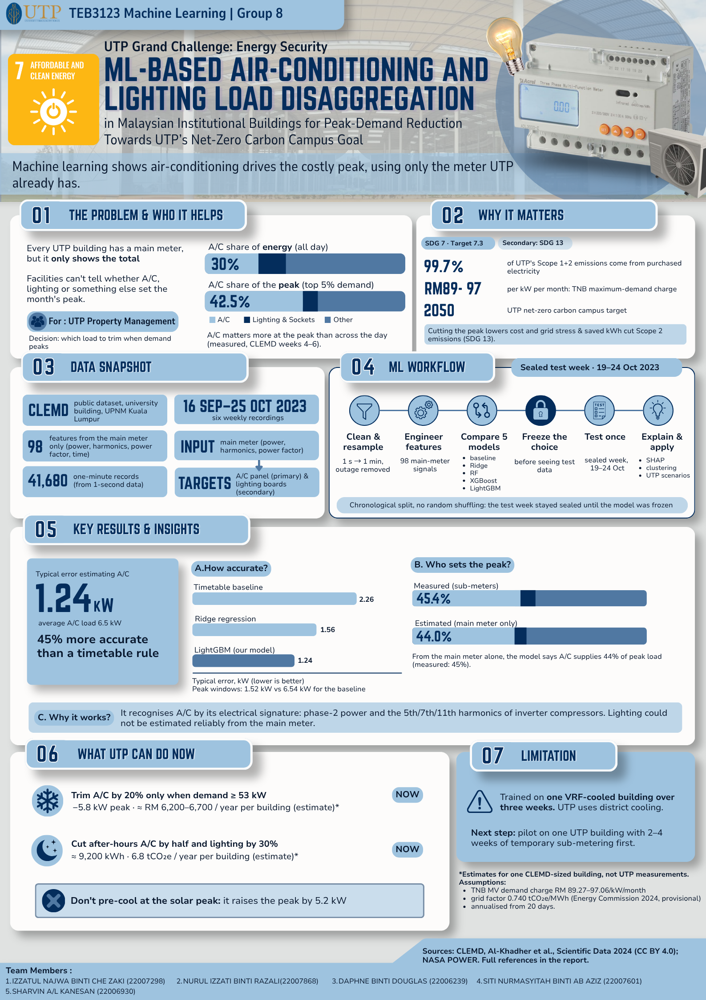

*(One page, placed immediately after the executive summary and before the table of contents. In the Word file, put it on its own section page with no header or footer. Apply the poster fixes in `REPORT_CHANGES.md` Section G before exporting.)*

---

## Table of Contents

*(In Word: References → Table of Contents, built from the Heading 1/Heading 2 styles. Then Insert Table of Figures twice: once for "Figure" captions (List of Figures) and once for "Table" captions (List of Tables). Update all fields before exporting to PDF.)*

- Executive Summary
- Project Infographic
- Chapter 1 Introduction and Problem Definition
- Chapter 2 Data Understanding and Exploratory Data Analysis
- Chapter 3 Data Preprocessing
- Chapter 4 Feature Engineering and Selection
- Chapter 5 Machine Learning Methodology
- Chapter 6 Evaluation Measures, Results and Discussion
- Chapter 7 Sustainability Insights and Recommendations
- Chapter 8 Limitations, Conclusion and Future Work
- References
- Appendix A Data Dictionary and Quality Checks
- Appendix B Model Settings, Tuning Ranges and Supplementary Results
- Appendix C Additional Results
- Appendix D Implementation Instructions
- Appendix E Team Contribution Record

---

## Chapter 1 Introduction and Problem Definition

### 1.1 Background and context

Due to Malaysia's hot and humid climate, buildings are the primary consumers of electricity, with air-conditioning (A/C) representing the largest load. As an empirical benchmark, an energy audit of an institutional building at Universiti Malaya found that air-conditioning used 34% of its electricity and lighting 18% [7]. An audit of air-conditioned offices found air conditioners using 57%, with lighting at 19% [9], and a government guideline puts air-conditioning and mechanical ventilation in typical office buildings at about 49% [8]. Although the shares vary between buildings, A/C is consistently the largest load, usually followed by lighting.

Cooling matters even more at the peak than across the day. Every month, large Malaysian electricity consumers pay a maximum-demand charge set by their highest 15-minute window [10]. Under the tariff schedule that took effect on 1 July 2025 [11], this charge is divided into capacity and network charges. Both are still charged per kW of maximum demand, and together they come to about RM 89.27 per kW per month for medium-voltage users on the standard tariff, or RM 97.06 per kW on the time-of-use tariff [3], [4]. According to TNB, the reform is intended to promote "load smoothing" [12].

UTP has already acted on both energy cost and peak demand. Optimising its District Cooling Plant (DCP) to reduce maximum-demand charges saves RM 1.0 million a year [13]. Other initiatives, including LED replacement and rescheduled operations, have cut its projected annual electricity bill from RM 22.80 million to RM 21.21 million [5]. A 7.4 MWp rooftop solar system meets more than a quarter of campus demand [14], and a second phase brought rooftop capacity to 7.7 MW [15]. All campus buildings are equipped with energy meters connected to the Integrated Building Management System (i-BMS) [5], and UTP has committed to a net-zero carbon campus by 2050 [16]. Purchased electricity accounts for 20.27 of UTP's 20.33 million kgCO₂e of Scope 1 and 2 emissions a year [2], so almost every tonne of CO₂ the campus emits comes from the grid.

Although UTP has installed energy meters in its buildings, these meters mainly measure overall electricity consumption. Installing separate meters on every A/C and lighting circuit would be costly and disruptive. Non-intrusive load monitoring (NILM), introduced by Hart, offers an alternative by estimating individual loads from the signals at a single main meter [17]. These signals include real and reactive power, power factor, harmonic distortion and how they change over time [18]. However, NILM is harder in commercial buildings than in homes, because large HVAC systems with variable-speed drives change their power draw continuously instead of switching cleanly on and off [19].

This research involves several important stakeholders. UTP Property Management is responsible for paying electricity expenses and managing maximum demand. The sustainability office focuses on reducing carbon emissions, and university management oversees campus energy-efficiency initiatives. Building occupants are affected indirectly, because their comfort depends on the A/C. The registered energy managers that Malaysia's Energy Efficiency and Conservation Act 2024 (Act 861) requires large energy users to appoint are also stakeholders, as they support compliance with the Act [20]. The study uses one university building in Kuala Lumpur, recorded from 16 September to 25 October 2023, as a stand-in for a UTP campus building. The scope of the study is detailed in Section 1.4.

### 1.2 Problem statement

Campus electricity drives UTP's carbon footprint and energy bill, but its building meters cannot show which loads cause the costly demand peaks. As a result, peak-reduction and efficiency measures cannot be targeted or verified building by building.

When a demand peak appears, facilities staff cannot tell from the main meter what caused it. Energy used after office hours is not identified by load either, so UTP bears the cost of demand charges set by peaks whose cause is unknown. Measures such as set-point changes or after-hours shut-off are applied blindly, with no way to check their effect.

The data show that A/C drives the peak. Figure 1 compares A/C's share of the building's energy with its share during the building's peak-demand windows. A/C consumes 30.1% of the energy across all 15-minute periods in weeks 4–6. Its share increases to 42.5% in the top 5% of demand windows, whilst the lighting and socket share decreases from 14.4% to 8.8%. Every one of those peak windows occurred between 08:00 and 17:00 on a weekday.

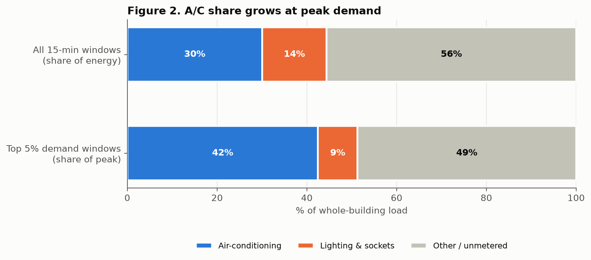

*Figure 1. Share of building energy versus share of the top 5% 15-minute demand windows, by circuit (CLEMD weeks 4–6, measured sub-meters).*

The total electricity consumption of the building alone cannot accurately determine how much energy is used by air-conditioning. For example, when total demand is between 40 and 60 kW during office hours, A/C consumption can vary from approximately 4 kW to 35 kW (Figure 9, Section 2.5). Therefore, using a fixed percentage to estimate A/C consumption would produce inaccurate results. Combining several electrical properties, such as power consumption, harmonic distortion, power factor and temporal patterns, is a more dependable method. Labelled data from individual electrical circuits (sub-metered data) can be used by machine learning algorithms to learn these relationships, and the trained model can then estimate the consumption of specific equipment from the main meter's data alone. CLEMD is the first publicly accessible dataset in Malaysia that includes circuit-level electricity consumption [6]. Its authors identify disaggregation as a potential use, but no machine learning disaggregation results using this dataset have been published [6].

### 1.3 Aim and measurable objectives

The project aims to develop and evaluate machine-learning models that estimate a building's A/C and lighting load from its main incoming meter, and to turn those estimates into peak-demand, solar-timing and emissions insights that UTP's facilities and sustainability teams can act on.

*Table 1. Objectives and where each is evidenced.*

| No. | Objective | Evidence of completion |
|---|---|---|
| O1 | Build a clean, time-aligned 1-minute modelling dataset from the CLEMD main supply and A/C, lighting and socket circuits, documenting every data-quality issue found. | Chapter 3; 41,680 records in `data/processed/clemd_1min.parquet`; Tables 5 and 8 |
| O2 | Develop regression models that estimate A/C power (primary) and lighting-and-socket power (secondary) from main-meter features only, and show whether they beat simple baselines on a sealed test week, overall and in the highest-demand 15-minute windows. | Chapters 5–6; Tables 12–14; Figures 12–18 |
| O3 | Explain which electrical and temporal signals the A/C model relies on, and check whether they make physical sense. | Sections 4.4 and 6.8; Table 9b; Figures 19–22; Table 16 |
| O4 | Cluster daily load profiles into operating modes and measure A/C and lighting energy used outside office hours. | Section 6.8; Figure 23; Table 17 |
| O5 | Turn the model's estimates into clearly labelled UTP scenarios (peak-demand kW and RM, A/C timing against rooftop solar, avoided tCO₂e) and recommendations. | Chapter 7; Tables 18–20; Figures 24–27 |

### 1.4 Sustainability alignment and scope

**A. Primary alignment: Energy Security, SDG 7 (Affordable and Clean Energy), Target 7.3** (double the global rate of improvement in energy efficiency) [21]. The project works through three mechanisms:

1. It turns meters UTP already owns into a diagnostic tool that shows which load sets each peak, so peak-reduction measures can be aimed at the right equipment.
2. Lower peaks reduce demand charges and the stress the campus's afternoon peak puts on the grid, which makes campus energy more affordable and secure.
3. Matching A/C timing with on-site rooftop solar tests whether more clean, self-generated energy can be used.

**B. Secondary alignment: Regenerative Futures, SDG 13 (Climate Action).** Every kWh saved avoids Scope 2 emissions at the grid emission factor [22]. This supports UTP's 2050 net-zero commitment [16] and Malaysia's national target [23]. We treat this as secondary because the carbon effect for one building is small (Section 7.3); the main value is in energy efficiency and demand.

**Scope.** This report covers the regression of A/C and lighting power at 1-minute resolution, k-means clustering of daily load profiles, and scenario analysis combining model estimates with published UTP, TNB, Energy Commission and NASA figures. It does not include real-time control or deployment on UTP's i-BMS. Seasonal change is not considered, because the data cover only September–October 2023. Other buildings are not included; the study is limited to one institutional building in Kuala Lumpur. The optional 15-minute-ahead forecasting extension and the 1-D CNN stretch goal from the proposal were not attempted.

### 1.5 Expected and achieved outcomes

*Table 2. Proposed outcomes versus what was achieved.*

| Proposed outcome (proposal §1.3) | Status | Notes |
|---|---|---|
| Working A/C disaggregation model in reproducible code | Completed | LightGBM, frozen before testing; full pipeline reruns from raw data with one command (Appendix D) |
| Peak-driver profile from model estimates | Completed | 44.0% estimated vs 45.4% measured A/C share of peak (Section 7.1) |
| SHAP evidence of the electrical signature | Completed | Phase-2 power and 5th/7th/11th harmonics (Section 6.8) |
| Load-profile clusters and after-hours estimate | Completed | k = 2 modes; a public holiday found from the main meter alone |
| UTP scenarios (kW, RM, solar, tCO₂e) | Completed, with one finding reversed | Pre-cooling into the solar peak was proposed but turns out to raise the peak; we now recommend a demand-triggered trim instead |
| Lighting model | Completed, negative result | Not reliable from the main meter with this data (Section 6.5) |
| Forecasting extension, 1-D CNN, NASA temperature feature | Not attempted | All three were optional and were dropped first, as the proposal's contingency plan specified |
| Benefits for UTP (RM saved, tCO₂e avoided) | Hoped-for, not measured | Need deployment on a UTP building; reported as scenarios only |

Since the proposal, some changes have been made. Clustering now uses the main-meter profile only, rather than the A/C and lighting profiles, so it works in buildings without sub-meters. Lighting training was extended to weeks 2–3, as the proposal planned. The work plan's internal target date of 15 November moved forward to the official deadline of 13 November.

Figure 2 summarises how the project connects Problem → Data → Features → Machine Learning → Evaluation → Interpretation → Sustainability.

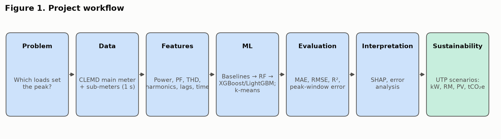

*Figure 2. Project workflow, from problem to sustainability scenarios, in the same order as the code.*

---

## Chapter 2 Data Understanding and Exploratory Data Analysis

### 2.1 Dataset provenance and suitability

CLEMD was recorded in the low-voltage switch room of the Faculty of Medicine and Defence Health building at Universiti Pertahanan Nasional Malaysia (UPNM), Kuala Lumpur. Each circuit was sampled at 200 kHz by power-quality loggers, which are summarised as one row per second in the published files [6]. Three factors make the data appropriate for this project:

- it comes from an actual Malaysian institutional building;
- it records the main incoming supply (model input) at the same time as the outgoing circuits, including a dedicated A/C panel (targets), providing measured ground truth that is rarely found in public non-residential datasets;
- its A/C and lighting energy shares (30.1% and 14.4%) are comparable to those of the Universiti Malaya institutional building (34% and 18%) [7].

*Table 3. Dataset provenance.*

| Attribute | Detail |
|---|---|
| Source and access | "CLEMD, a circuit-level electrical measurements dataset", Al-Khadher et al., *Scientific Data* 2024 [6]; data on figshare [1]; downloaded October 2026 |
| Coverage | One institutional building, UPNM, Kuala Lumpur; 16 Sep–25 Oct 2023 in six weekly folders; 1-second sampling |
| Observation unit | Raw: one second of one circuit. Modelling: one minute of the building (main meter + sub-meters joined on timestamp) |
| Original size | 42 CSV files, about 5.9 GB extracted, 0.35–0.52 million rows and 59 columns per file |
| Task and outcome | Supervised regression: A/C real power (kW), primary; lighting-and-socket real power (kW), secondary. Unsupervised clustering of daily profiles (no target) |
| Use constraints | CC BY 4.0 (free use with citation); building-level electrical data only, no personal data |

Each weekly folder contains one CSV per metered circuit. **Aggregate** is the building's main incoming supply and the source of every model input. **CP AC** is the A/C control panel feeding six 10 hp variable-refrigerant-flow (VRF) rooftop units and is the primary target. **DB TG**, **DB T1** and **DB ML 1** are distribution boards serving mainly lighting plus sockets; their sum is the secondary target. **DB ML 2**, **EMSB 1** (emergency main switchboard) and **SSB MF** (a sub-switchboard) are used only for context. Some circuits in the building (FP 1, PUMP CP, DB RA) were never metered [6], so the main supply always reads more than the sum of the sub-meters.

We also used hourly irradiance for the UTP campus (4.385° N, 100.979° E, October 2023) from NASA POWER [24] for the solar-timing scenario. *These data were obtained from the NASA Langley Research Center (LaRC) POWER Project funded through the NASA Earth Science/Applied Science Program.*

### 2.2 Data dictionary

All model inputs come from the Aggregate (main-meter) file. Table 4 lists the key variables; Appendix A lists all 98 engineered features.

*Table 4. Key variables.*

| Variable | Meaning and unit | Type | Role |
|---|---|---|---|
| `Date`, `Time` | Timestamp of each 1-s record (12-hour clock; mixed D/M/Y and M/D/Y) | Datetime | Index; source of calendar features |
| `Voltage1–3`, `VoltageN` | Phase and neutral voltage (V) | Continuous | Input; also used to detect the outage |
| `Current1–3`, `CurrentN` | Phase and neutral current (A) | Continuous | Input |
| `Frequency` | Supply frequency (Hz) | Continuous | Input |
| `Real Power1–3` | Active power per phase (W) | Continuous | Input; summed to total kW |
| `Apparent Power1–3` | Apparent power per phase (VA) | Continuous | Input |
| `Reactive Power1–3` | Reactive power per phase (VAR); separates motor and inverter loads from resistive ones | Continuous | Input |
| `PF1–3` | Power factor per phase (0–1) | Continuous | Input |
| `THD1–3`, `THDN` | Total harmonic distortion of current (%) | Continuous | Input |
| `Current{1,2,3,N}H{1,3,…,15}` | Odd current harmonics, % of the fundamental (H1 is fixed at 100) | Continuous | Input (32 columns) |
| **`ac_kw`** | CP AC Real Power 1+2+3, 1-minute mean (kW) | Continuous | **Primary target** |
| **`light_kw`** | DB TG + DB T1 + DB ML 1 real power, 1-minute mean (kW) | Continuous | **Secondary target** |
| `week` | CLEMD weekly folder number (2–6) | Integer | Splitting only, never a model input |

For clustering there is **no supervised target**. The input is each day's 24-hourly building load (main meter), normalised by that day's maximum.

### 2.3 Target definition and data availability

The study focuses on estimating the actual power consumption of the air-conditioning and lighting systems using data from individual sub-meters. A/C consumption is calculated by adding the power readings from its three phases and dividing the total by 1,000 to obtain kW. Similarly, lighting consumption is calculated by adding the readings from the three lighting boards. Both values are averaged over the same one-minute period as the main-meter readings. This study uses a *nowcasting* approach rather than forecasting: the model estimates the A/C consumption in the current minute using the main-meter data available up to that time.

To ensure that the model produces reliable results, only information available from the main meter is used as input. Sub-meter readings, future data and identifiers such as week numbers are excluded from the input variables. Although the total building power includes A/C consumption, this does not create data leakage, as the main meter represents exactly the data available when applying the model in a real building. The purpose is to separate the total electricity consumption into individual components, particularly A/C and lighting usage.

However, the availability of data differs across the recorded weeks, as shown in Figure 3. Week 1 is excluded because it does not contain an Aggregate file, while Weeks 2 and 3 do not have CP AC readings. Therefore, A/C consumption data is only available for Weeks 4 to 6, covering 4 to 25 October 2023. Lighting consumption data is available from Weeks 2 to 6. Each weekly folder contains approximately six days of data, with missing records on 27 September, 4 October, 11 October and 18 October.

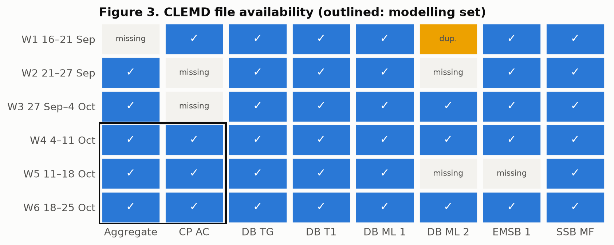

*Figure 3. CLEMD file availability by week and circuit. The outlined block is the A/C modelling set; "dup." marks the duplicated file described in Section 2.4.*

**Mismatch with the intended application.** The CLEMD building is cooled by rooftop VRF units whose compressors sit on the building's own supply. Much of UTP is instead served by a district cooling plant [13], where a building meter sees fans and pumps rather than compressors. The trained model therefore cannot be copied to UTP; only the method transfers (Section 8.1).

### 2.4 Data quality profile

We measured every issue on the raw files before choosing a treatment.

*Table 5. Data quality profile (before cleaning).*

| Quality check | Evidence before cleaning | Response |
|---|---|---|
| Missing files | Week 1: no Aggregate. Weeks 2–3: no CP AC. DB ML 2 missing in weeks 2 and 5; EMSB 1 missing in week 5 | Week 1 excluded; A/C modelling restricted to weeks 4–6; DB ML 2 not used in the lighting target |
| Blank rows | About 33,000 empty rows at the end of several files | Dropped (rows with no `Date`) |
| Duplicate file | Week 1 `DB ML 2.csv` is byte-for-byte identical to `SSB MF.csv` | Excluded (week 1 is not used anyway) |
| Misnamed file | Week 4 main supply is spelt `Aggregtae.csv` | Mapped explicitly by the loader |
| Inconsistent date formats | Some files use M/D/Y and others D/M/Y, sometimes within the same folder; automatic parsing would silently shift files by a month | For each file, the loader picks the format that maps the first row to that folder's known start date |
| Invalid values (outage) | 5 Oct 2023, 14:49–17:03: every circuit reads ≈ 0 V and 0 kW for 135 minutes | Removed as a supply outage, not zero demand (rule: phase-1 voltage < 100 V) |
| Time gaps | One unrecorded day between each pair of weekly folders, plus the outage | Lag and rolling features are never computed across a gap (Section 4.5) |
| Harmonic units | All `Current*H1` columns equal 100.0 in every row: harmonics are already reported as % of fundamental, not amperes as our proposal assumed | Documented. Ratio features therefore duplicate the raw harmonics (Section 4.2) |
| Unmetered loads | ≈ 55% of building energy comes from circuits outside both targets, some never metered | Kept. A real main meter sees the same mix |
| Duplicated timestamps / class coverage | No duplicate timestamps after joining. Regression task, so no class imbalance; peak windows are rare by design (≈ 5%) | Peak-window metric with day-block bootstrap CIs (Section 6.3) |

The paper is inconsistent about how many circuits were measured [6], so we relied on the files themselves.

### 2.5 Exploratory visualisations

The exploratory analysis below uses weeks 4–6, the weeks with A/C ground truth. Over those weeks the building drew an average of 20.3 kW, of which A/C averaged 6.1 kW. The highest 15-minute demand was 83.9 kW (31.7 kW of it A/C), and the highest single minute was 94.6 kW.

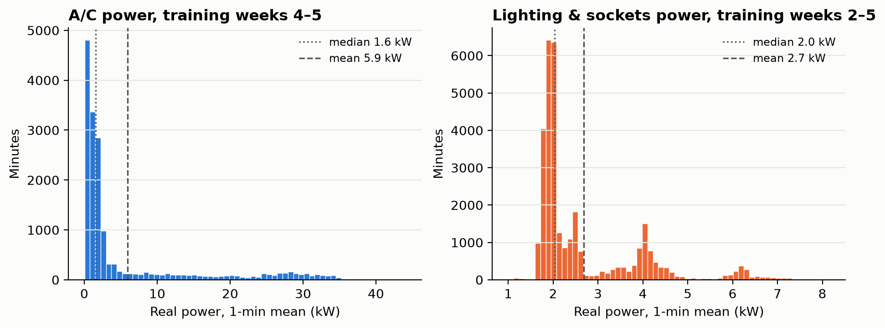

*Figure 4. Distribution of the two targets over their training weeks (1-minute means): A/C, weeks 4–5 (16,985 minutes); lighting and sockets, weeks 2–5 (32,725 minutes).*

Figure 4 shows that both targets are right-skewed (skewness 1.88 for A/C and 1.72 for lighting and sockets), but they follow different consumption patterns.

Around 28.4% of A/C training minutes are below 1 kW, mainly at weekends when the A/C units are not operating, while A/C can rise as high as 44 kW on weekday afternoons. The large gap between the median (1.6 kW) and the mean (5.9 kW) shows that a few periods have much higher consumption.

The lighting consumption range, on the other hand, is much narrower than that of A/C, and it has several peaks (a multi-modal distribution). The first peak, around 2 kW, is the basic electricity use of sockets, servers and security lighting. The second peak, around 4 kW, reflects higher use during working hours, and the third, around 6 kW, reflects increased lighting during busier periods. The pattern therefore reveals different levels of electricity use through the working day.

**Why it matters:** because A/C consumption varies so widely, a few high-demand periods can dominate the average error. The study therefore uses peak-window MAE to assess errors separately during peak-demand periods. Because of the large gap between low-consumption (night) and high-consumption (day) hours, R² looks high almost automatically and is not used as a main performance metric. The lighting target's narrow range means even a small absolute error is a large relative one.

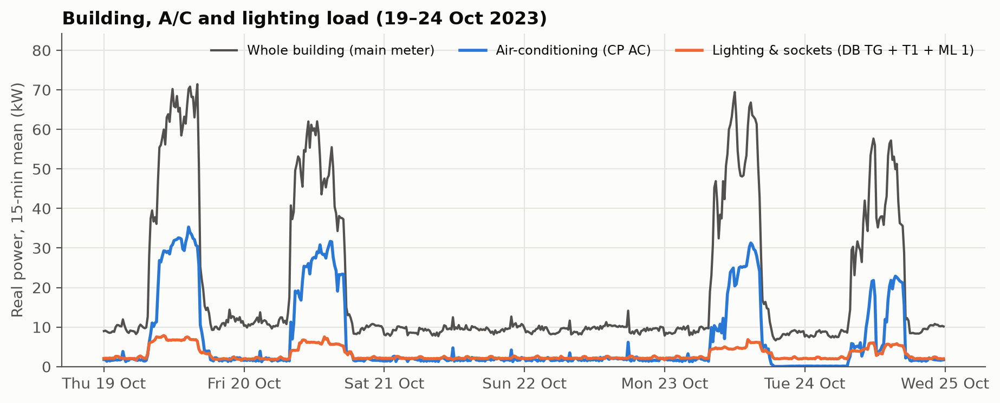

*Figure 5. Building, A/C and lighting-and-socket load, 19–24 October 2023 (15-minute means, measured sub-meters).*

Figure 5 shows that building demand rises sharply on weekday mornings and falls in the late afternoon, and that A/C (blue line) accounts for most of that swing. Lighting and sockets (orange line) form a smaller, steadier load. The A/C peak on Tuesday 24 October was much lower than on the Monday before, so day-to-day variation is real and a model must capture it rather than repeat an average day.

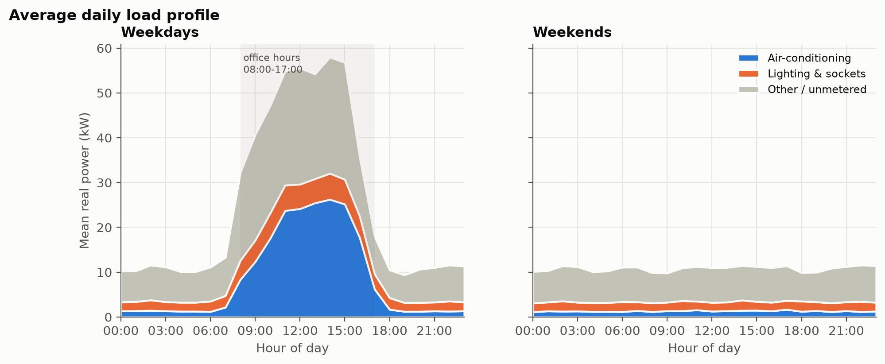

*Figure 6. Average daily load profile by circuit, weekdays and weekends (weeks 4–6).*

On weekdays, A/C ramps up from about 08:00, peaks around 14:00 and falls away after 17:00. At weekends the building runs at a nearly flat baseline of about 10 kW, most of it unmetered or "other" load. Overnight (00:00–06:00) the building still draws 10.6 kW on average, of which A/C is 1.3 kW. Time of day explains a lot, so a time-of-day average is the natural baseline a model must beat.

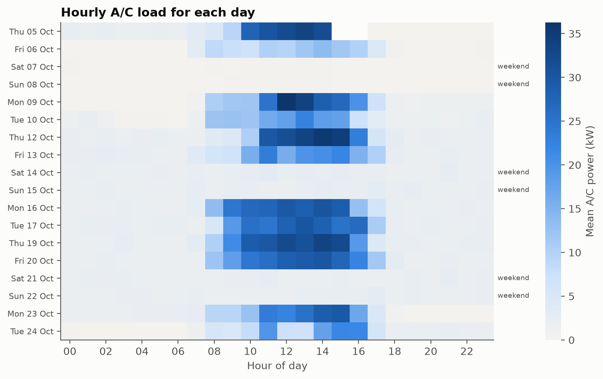

*Figure 7. Hourly mean A/C load (kW) for each day, weeks 4–6. The white block on 5 October is the supply outage.*

Figure 7 shows that some weekdays (Friday 6 October, Tuesday 10 October and Tuesday 24 October) are much lighter than others, which points to timetable and occupancy effects. There are distinct kinds of day, and these are what the clustering step is designed to find.

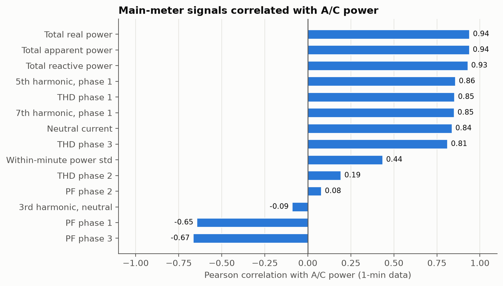

*Figure 8. Pearson correlation of selected main-meter signals with measured A/C power (1-minute data, weeks 4–6).*

Total real power is the strongest single signal (r = 0.94). The 5th and 7th harmonics and THD on phase 1 follow closely (r = 0.85–0.86), as expected if the inverter-driven VRF compressors inject those harmonics. Power factor on phases 1 and 3 falls as A/C rises (r ≈ −0.65), but phase 2 behaves differently (r = 0.08), so the A/C load is not spread evenly across phases. Harmonics carry A/C-specific information beyond total power, and the many strongly correlated inputs need regularisation (Ridge) or tree models. Correlation is not causation: these are associations in one building.

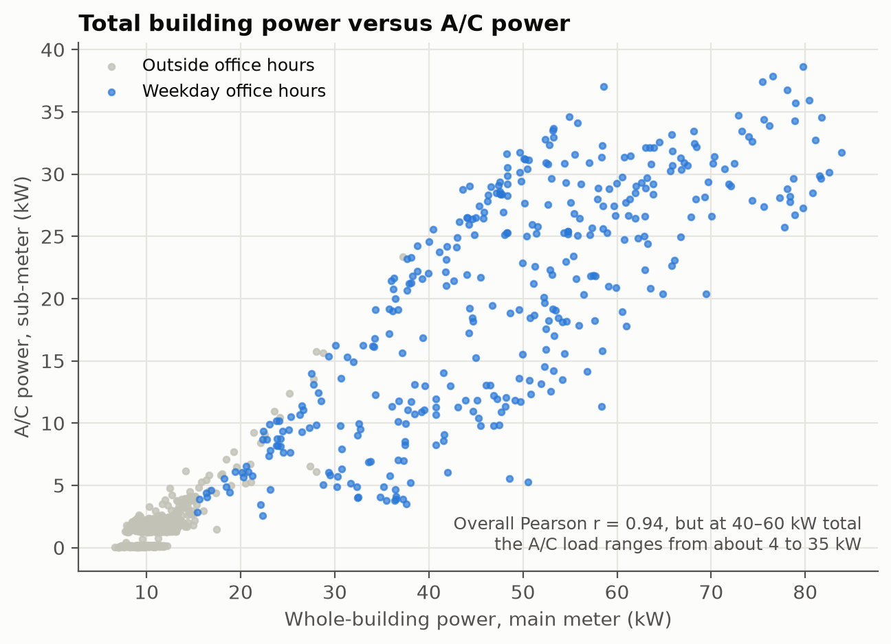

*Figure 9. Total building power versus A/C power, 15-minute windows; office-hours windows highlighted.*

Outside office hours (grey), A/C and total load move together closely. During weekday office hours (blue), a total of 40–60 kW can hide anywhere from about 4 kW to 35 kW of A/C. This ambiguous band is exactly where peaks happen, and Chapter 6 shows it is where the model's error is largest.

### 2.6 Insights that shape the methodology

*Table 6. How each data observation changed the workflow.*

| Observation | Change to the workflow |
|---|---|
| Neighbouring minutes are almost identical (time series) | Chronological split with a sealed test week; expanding-window CV with a 60-minute gap; no random splits [25] |
| A/C is a larger share of the peak (42.5%) than of energy (30.1%) (Figure 1) | Peak-window MAE added as a key metric |
| Strong daily and weekly rhythm (Figures 6 and 7) | Calendar features; time-of-day average as Baseline 1 |
| The total is ambiguous in office hours (Figure 9) | Non-linear models plus harmonic and power-quality features, not total power alone |
| Many highly correlated electrical signals (Figure 8) | Ridge (L2) for the linear model; SHAP and permutation importance interpreted by feature group |
| Data gaps between weeks and at the outage | Lags and rolling windows computed within contiguous segments only |
| Only ≈ 29 peak windows in a test week | Day-block bootstrap confidence intervals |
| Distinct kinds of day (Figure 7) | k-means on normalised daily profiles |

The descriptive figures in our proposal (Figures 1 and 5–9) include the measured loads from week 6, because they were drawn from weeks 4–6. No model, feature or hyperparameter was ever fitted, tuned or selected on week 6. Only weeks 2–5 were used for the feature-redundancy check, the feature ablation and all cross-validation, and the model choice was written down before any model saw week 6. Nonetheless, we explicitly acknowledge that a look at the test week was part of our overall view of the data.

---

## Chapter 3 Data Preprocessing

### 3.1 Preparation sequence

**Data preparation and feature engineering workflow.** All data preparation and feature engineering procedures are implemented in `prepare_data.py` and `features.py`. The raw CSV files are processed once and converted into Parquet format, so every later stage starts from the same data source.

The workflow consists of the following steps:

1. **Data loading.** The Aggregate file, containing all 59 columns, is loaded from each weekly folder. In addition, the CP AC, DB TG, DB T1 and DB ML 1 files are loaded using only the date, time and real power columns. At this stage, file-naming inconsistencies and differences in date formats are resolved.
2. **Data cleaning.** Trailing blank rows are removed, and the remaining values are converted into numbers.
3. **Temporal resampling.** The one-second measurements are resampled into one-minute intervals. The mean is calculated for each main-meter signal, and the standard deviation, minimum and maximum are also calculated for total real power to capture variation within each minute.
4. **Data integration.** The main-meter and sub-meter data are merged on their minute timestamps. Only minutes with valid readings from the main meter and all three lighting boards are kept.
5. **Outage removal.** Electrical outages are identified with a phase-1 voltage threshold of less than 100 V and excluded, so that abnormal readings during power interruptions do not affect the analysis.
6. **Target derivation.** `light_kw` is calculated by summing the real power of DB TG, DB T1 and DB ML 1, giving the combined consumption of the three lighting boards.
7. **Feature engineering.** The features described in Chapter 4 are generated within contiguous data segments, so no feature reaches across a gap. Rows with incomplete 60-minute lag windows are then removed.
8. **Data partitioning.** The model-ready data are partitioned by CLEMD week, as described in Section 5.3.

Figure 2 in Section 1.5 illustrates the complete workflow, and Figure 10 shows the record counts at each step.

**Observation counts throughout the processing pipeline.** The initial dataset consists of 42 raw CSV files containing one-second measurements. Weeks 2–6 are selected for processing, while Week 1 is excluded because it has no main-meter data. After data integration, 41,815 minute-level observations are obtained. After removing the 135 outage minutes, the dataset contains 41,680 clean observations across 69 columns. Feature engineering then removes 365 observations with incomplete 60-minute lag windows, leaving a final model-ready dataset of **41,315 observations**. These are allocated as follows:

- A/C model: 16,985 training observations (Weeks 4–5).
- Lighting model: 32,725 training observations (Weeks 2–5).
- Testing dataset: 8,590 observations (Week 6).

At the end of each run, both `prepare_data.py` and `features.py` perform a series of `assert` checks: all timestamps fall within September–October 2023, timestamps are strictly increasing with no duplicates, A/C values are present only where CP AC data exists, and lag features never cross a gap. These checks make the whole preparation process reproducible, traceable and verifiable from the raw data.

### 3.2 Cleaning and missing values

*Table 7. Cleaning rules and their effect.*

| Step | Rule and rationale | Effect on dataset |
|---|---|---|
| Blank rows | Drop rows with no date, since they carry no data | ≈ 33,000 rows per affected raw file |
| Date parsing | Choose M/D/Y or D/M/Y per file so row 1 equals the folder's known start date. Automatic parsing would silently misplace files | All files land in 21 Sep–25 Oct 2023 (checked by `assert`) |
| Units | Sum three phases and divide by 1,000 to give kW, kVAR and kVA | Totals for building, A/C and lighting |
| Missing circuits | No imputation, because a missing A/C file means no ground truth, and inventing a target would teach the model its own guesses | Weeks 2–3 contain 15,862 minutes with missing `ac_kw` values. These weeks are used only for lighting, clustering and out-of-sample scenario estimates |
| Missing minutes inside weeks | None in the A/C weeks after joining. However, 5 minutes had a single 1-s sample, so no within-minute standard deviation | Those 5 rows are dropped with the incomplete-lag rows |
| Gap days and outage | Left as gaps, not filled. Interpolating 135 minutes or a whole day would create fake load shapes | Features never span a gap (Section 4.5) |

**Risk of losing meaningful observations.** The only rows removed are the outage, blank rows and 365 minutes at segment starts whose lag history is incomplete (0.9% of clean minutes). No high-demand minute was removed.

### 3.3 Outliers and unusual cases

We checked extreme values against what the building could physically do rather than applying a statistical cut-off. The outage is an invalid reading (0 V on every circuit at once) and was removed. Short demand spikes up to 94.6 kW for the building and 44.1 kW for A/C occur on weekday afternoons and coincide with A/C ramps, so they are real peaks. In a peak-demand study, they are the most important observations, so they were kept unchanged. No capping or transformation was applied to the inputs or targets. Averaging from 1 second to 1 minute reduces sensor noise and small clock misalignment between the separate loggers.

### 3.4 Encoding, scaling and imbalance

- **Encoding.** The dataset contains no categorical text variables, so no categorical encoding is required. The hour of day is represented with cyclical sine and cosine transformations, so 23:00 and 00:00 are treated as close. The day of the week is an integer from 0 to 6, which tree-based models can split on directly. Weekend and office-hours indicators are binary variables. Since there are no text categories, unknown-category handling is not required.
- **Scaling.** Feature scaling is applied only to the Ridge regression model, because its regularisation penalty is sensitive to feature magnitudes. A `StandardScaler` inside a scikit-learn pipeline standardises the inputs. The scaler is fitted only on the training data within each cross-validation fold and then applied to the corresponding validation or test data, which prevents information leaking from the validation or test sets. Tree-based models do not need scaling, because their splits do not depend on feature magnitude, so they use the original values.
- **Class imbalance.** Since the task is regression, class imbalance does not apply. However, peak-demand periods are a small share of the observations, defined as the top 5% of demand. To preserve the time series, no resampling is applied. Instead, performance during peak-demand periods is evaluated separately with a dedicated peak-window metric, with bootstrap confidence intervals to show the uncertainty.

### 3.5 Final prepared dataset

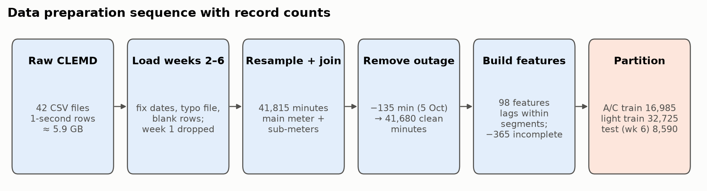

*Figure 10. Data preparation sequence, from raw CLEMD files to model-ready partitions, with record counts at each step (generated from the code, so the counts are those of the submitted pipeline).*

*Table 8. Final prepared dataset.*

| Item | Value |
|---|---|
| Clean 1-minute records | 41,680 (weeks 2–6, 21 Sep 23:55 – 25 Oct 00:05, 2023) |
| Model-ready records | 41,315 |
| Features | 98 (all from the main meter or the clock) |
| A/C target (training weeks 4–5) | mean 5.92 kW, median 1.58 kW, SD 9.49 kW, max 44.07 kW: strongly right-skewed, with long near-zero periods at night and weekends |
| Lighting target (training weeks 2–5) | mean 2.68 kW, SD 1.23 kW, range 1.00–8.16 kW |
| Test week (week 6) | 8,590 minutes; A/C mean 6.5 kW, lighting mean 3.1 kW |
| Remaining issues | Unmetered loads; possible small logger clock offsets; lighting level drifts upward from September (≈ 2.5 kW) to October (≈ 3.0 kW) |
| Where it lives in the code | `data/processed/clemd_1min.parquet` (from `prepare_data.py`); features built on the fly by `features.build()` |

---

## Chapter 4 Feature Engineering and Selection

### 4.1 Feature design rationale

All features are derived only from main-meter measurements or time-related variables, with no sub-meter data used as input. This means the model can be used in buildings that have only a main meter, without installing extra sub-meters. The 98 features are organised into five groups, as summarised in Table 9. The complete list of features is provided in Appendix A.

*Table 9. Feature groups.*

| Group (count) | Feature / construction | Reason for inclusion |
|---|---|---|
| Power (15) | Real, reactive and apparent power for each phase. Derived features include total kW, kVAR and kVA, and the standard deviation, minimum and maximum of total kW within each minute | Captures overall consumption and differences in load distribution across phases. Within-minute statistics capture short-term demand variation, such as compressor cycling |
| Power quality (16) | Voltage and current for each phase and the neutral line, frequency, power factor (PF) and total harmonic distortion (THD) | Captures changes in electrical conditions that may indicate different types of operating load, including A/C equipment |
| Harmonics (53) | 32 original odd-order current harmonics (H1–H15) across three phases and the neutral line. 21 derived harmonic ratios (Hn/H1, n = 3–15) for each phase | Captures harmonic patterns of non-linear loads, particularly inverter-driven A/C systems and their characteristic harmonics [26] |
| Temporal (9) | Total kW lagged by 1, 5, 15 and 60 minutes; rolling mean and standard deviation over 15 and 60 minutes; one-minute change in total kW | Captures recent consumption patterns, demand trends and sudden changes associated with equipment switching |
| Calendar (5) | Hour of day encoded with sine and cosine, day of week, weekend indicator and office-hours indicator (weekdays 08:00–17:00) | Captures recurring daily and weekly patterns associated with building occupancy and operating schedules |

**Calculation of key derived features.** `p_lag15` is total real power measured 15 minutes earlier. `p_roll60_mean` is the average total real power over a 60-minute window, including the current minute. `ratio_3H5` is the phase-3 fifth-harmonic current divided by its fundamental current. `office_hours` is 1 on weekdays between 08:00 and 16:59, and 0 otherwise.

**NASA temperature feature.** Although listed as an optional feature in the proposal, NASA temperature data was not used in the final model. Hourly temperature is constant across all minutes in the same hour and largely overlaps with time-of-day information over the three-week period, so it would add little new information.

### 4.2 Feature selection

All 98 features were kept and no automatic selection was applied. We justify this rather than invent a selection stage. The reasons are:

1. **Redundancy was measured on development data only.** `features.py` computes absolute correlations among all features on weeks 2–5 (never the test week) and lists 130 pairs with |r| > 0.98 (`results/redundant_feature_pairs.csv`). Examples include phase current and apparent power (r = 0.9999) and total kW and kVA (r = 0.9997).
2. **The models chosen tolerate redundancy.** Ridge's L2 penalty shares weight among correlated inputs instead of letting it explode [27]. Trees simply pick one of several equivalent splits. Dropping features by hand risks removing the one variant that matters for a specific phase.
3. **Selecting by test performance is forbidden**, and selecting within CV folds over 98 features would have used up the small, fixed tuning budget agreed in the proposal.

**A finding we report honestly.** The redundancy check showed that each ratio feature correlates perfectly (r = 1.00) with its raw harmonic. The reason is that CLEMD already reports harmonics as a percentage of the fundamental: every `Current*H1` value is exactly 100. So the 21 ratio features are exact copies of the raw harmonics divided by 100, and the four H1 columns are constant. The model effectively has 73 distinct informative inputs. This does not affect accuracy (trees and Ridge are unaffected by exact copies), but it does split SHAP credit between twins such as `agg_Current3H5` and `ratio_3H5`. That is one reason we interpret importance by feature group (Section 6.8). The feature set was frozen before this was noticed, and we did not change it afterwards. The ablation in Section 4.4 confirms that removing the duplicates changes cross-validated error by only 2.4%, within the fold-to-fold spread.

### 4.3 Dimensionality reduction

**Not applicable.** PCA was not used. It would mix power, harmonic and calendar signals into components that a facilities team cannot interpret, and the tree models handle 98 inputs without difficulty (about 2 seconds to train LightGBM).

### 4.4 Evidence of usefulness

We compared feature sets directly under the **same validation protocol** used for model selection (`ablation.py`): the frozen LightGBM settings, the same four `TimeSeriesSplit` folds, A/C training weeks 4–5 only. Only the input columns change. The test week was not used, and the frozen model was not changed; this is evidence about the features, not a new model choice.

*Table 9b. Feature-group ablation, A/C, cross-validation on training weeks (mean of 4 folds).*

| Feature set | Features | CV MAE kW (± fold SD) | Change vs all features | CV peak-window MAE kW |
|---|---|---|---|---|
| **All features (frozen)** | 98 | **0.99 ± 0.22** | — | 2.59 |
| Without harmonics | 45 | 1.20 ± 0.28 | **+21%** | 2.30 |
| Without power quality | 82 | 0.99 ± 0.19 | +0.3% | 2.82 |
| Without temporal | 89 | 0.98 ± 0.25 | −1.2% | 2.85 |
| Without calendar | 93 | 1.05 ± 0.22 | +6.5% | 4.35 |
| Duplicates removed (ratios and constant H1) | 73 | 1.01 ± 0.19 | +2.4% | 3.15 |
| Power meter, no harmonics or power quality | 29 | 1.69 ± 0.30 | +71% | 4.11 |
| kW-only meter (total kW, temporal, calendar) | 18 | 2.01 ± 0.45 | +104% | 4.93 |
| Calendar only | 5 | 3.05 ± 0.87 | +209% | 6.55 |

What this shows:

- **Harmonics carry the most unique information.** Removing them raises typical error by 21%, which agrees with the permutation result in Table 16. Their peak-window error is slightly lower without them (2.30 vs 2.59 kW), but peak-window MAE rests on only a few windows per fold and varies widely (Section 6.3), so we do not read much into that difference.
- **Power-quality and temporal features add little on their own** (changes within ±1.3%, far inside the fold SD). Their information largely overlaps with power and harmonics. We kept them because the freeze rule fixed the feature set before testing, and they do not hurt.
- **Calendar features help mainly at the peak.** Typical error rises only 6.5% without them, but peak-window error rises from 2.59 to 4.35 kW. The frozen model uses calendar features little on average (Table 16), yet they help it place A/C correctly in the busiest windows.
- **Removing the duplicate features makes no meaningful difference** (+2.4%, within the fold SD), which confirms Section 4.2: the copies did not harm accuracy, but they are not needed.
- **The meter matters.** A meter that logs only total kW roughly doubles the error (2.01 kW), and a standard power meter without harmonics gives 1.69 kW. Both still beat the timetable baseline (CV MAE 2.99 kW, Appendix B) by 33% and 43% respectively. This is direct evidence for the adoption question in Section 7.4.

### 4.5 Leakage and interpretation checks

- **No target information:** no sub-meter column is used as an input, and `week` is used only to split the data.
- **No future information:** lags and rolling windows look only backwards (`shift` and trailing `rolling`), and are computed inside contiguous segments, so a lag never reaches across a missing day or the outage. An `assert` checks that the first minute after every gap has no lag-1 value.
- **No fold leakage in CV:** `TimeSeriesSplit(gap=60)` leaves 60 minutes between each training and validation fold, which is the length of the longest lag.
- **Redundancy check and ablation exclude the test week**, and peak windows are defined from building demand (an input), not from the target.
- **Interpretation limit:** a feature that predicts A/C well, such as the 5th harmonic, is a signature of A/C running, not a lever. Lowering harmonics would not lower cooling. Stakeholders act on the A/C itself.

---

## Chapter 5 Machine Learning Methodology

### 5.1 Task formulation and pipeline

The task is supervised regression. For a given minute *t*, the model takes the 98 features recorded from the building's main meter and estimates the active power (in kW) of the air-conditioning (A/C). A second regression model estimates the combined lighting and socket power from the same input features. In addition, an unsupervised clustering task groups whole days according to the shape of the main meter's daily load profile.

A simple decision rule is not enough to break down these loads. A fixed-share rule, such as assuming that A/C is 30% of the total, fails exactly in the office-hours windows that set the demand charge (Figure 9). A time-of-day timetable follows the daily pattern but cannot adjust to changes in occupancy from one day to the next. The machine learning model cuts the average error (MAE) by 45% compared with the time-of-day baseline (Table 12).

The end-to-end process is implemented in ten scripts, which run in this order:

1. `prepare_data`: cleans raw sub-meter and main-meter recordings and aligns timestamps (O1).
2. `features`: computes the 98 electrical, harmonic, temporal and calendar features for each minute and checks redundancy (O1).
3. `train`: fits the baselines, runs cross-validated hyperparameter tuning and freezes the winning models (O2).
4. `ablation`: retrains the frozen A/C settings on reduced feature sets under the same CV folds (Section 4.4) (O3).
5. `evaluate`: evaluates the frozen models once on the held-out test week, computes confidence intervals, and performs robustness and error analyses (O2).
6. `explain`: generates global and local feature attributions using SHAP and permutation importance (O3).
7. `cluster`: groups daily load profiles into building operating modes and quantifies after-hours energy (O4).
8. `scenarios`: simulates peak-demand reduction (kW), tariff savings (RM), solar timing and carbon reductions (tCO₂e) (O5).
9. `make_figures` and `report_figures`: export all report figures.
10. `build_dashboard`: compiles the interactive presentation dashboard.

### 5.2 Baseline and selected algorithms

Candidate algorithms were compared against a reference baseline for every task, to confirm that machine learning offers benefits over straightforward schedules (Table 10).

*Table 10. Baselines and selected machine learning approaches.*

| Task | Reference baseline | ML approaches |
|---|---|---|
| Regression (A/C and lighting-and-socket power) | Time-of-day average: predicts the mean training target for the matching hour and day type (weekday/weekend), without electrical inputs | Ridge regression: linear, L2 penalty (frozen for lighting); Random Forest: 200 bagged decision trees; XGBoost: 400 sequential shallow trees; LightGBM: 400 leaf-wise boosted trees (frozen for A/C) |
| Clustering (daily load-profile operating modes) | Calendar grouping: weekday vs weekend | k-means clustering with *k* chosen by silhouette score |

**Reasons for the reference baselines and chosen ML approaches:**

1. **Time-of-day average:** a timetable-only reference point. If a model cannot beat this baseline, the main meter's electrical signals add nothing beyond the timetable.
2. **Ridge regression [27]:** a straightforward, easy-to-interpret model that handles correlated variables well; total power alone correlates with A/C at r = 0.94. It is the default model unless a tree model clearly wins.
3. **Random Forest [28], XGBoost [29], LightGBM [30]:** able to model non-linear interactions among electrical signals (for example, high total power + strong 5th harmonic + office hours = A/C on), while remaining robust to outliers. XGBoost and LightGBM also support exact TreeSHAP explanations.
4. **k-means [31]:** identifies operating states without needing "day type" labels. The calendar grouping is the reference: Section 6.8 shows the clusters differ from it on two weekdays, one of them a public holiday.
5. **Method not included (1-D CNN):** excluded because deep NILM methods usually need months of training data [33]. With about three weeks of A/C data from one building, a deep model would be likely to overfit and would be much harder to explain to facilities managers.

### 5.3 Evaluation design

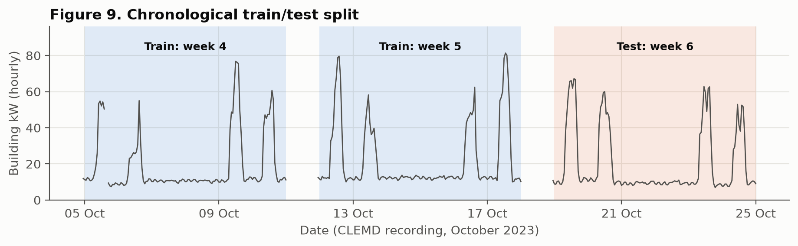

*Figure 11. Chronological split of the CLEMD data. A/C trains on weeks 4–5 and lighting on weeks 2–5. Both are tested once on week 6.*

- **Split (Figure 11).** Strictly chronological. A/C: train on weeks 4–5 (16,985 minutes, 66%), test on week 6 (8,590 minutes, 34%). Lighting: train on weeks 2–5 (32,725 minutes, 79%), test on week 6. A random split would leak information, because neighbouring minutes are nearly identical [25].
- **Cross-validation.** `TimeSeriesSplit(n_splits=4, gap=60)` within the training weeks: four expanding windows, each validating on the next block of time after a 60-minute gap. Every model and configuration uses the same folds.
- **Freeze rule, fixed before tuning.** Pick the best configuration of each model by mean CV MAE. Choose the tree model with the lowest CV MAE only if it is at least 5% below Ridge; otherwise choose Ridge. This follows the brief's preference for simple models.
- **Freeze and sealed test.** `features.load()` drops week 6 by default, so no tuning code can see it. The choice was written to `results/freeze.json` on 6 November 2026 and committed before week 6 was ever loaded. Week 6 was then evaluated once, and nothing was changed after seeing the results. Rerunning `train.py` never overwrites the freeze: it writes `freeze_rerun.json` and checks that the same choice is reproduced (rerun on 10 November: reproduced).
- **Robustness.** Separately, each model is trained on week 4 and tested on week 5, to see how it holds up across weeks.
- **Seeds.** `random_state=0` for all models and k-means; `numpy.random.default_rng(0)` for the bootstrap and permutation importance.

### 5.4 Training and hyperparameter selection

Models were trained with scikit-learn, XGBoost and LightGBM, using a compact hyperparameter grid fixed before tuning (the complete grid is in Appendix B). Grid search was performed on the four time-series CV folds, with mean CV MAE as the selection metric, giving 17 configurations × 4 folds × 2 targets = 136 fits. The number of trees was kept fixed, and no early stopping was used. Final configurations are shown in Table 11.

*Table 11. Final settings. Values in the "Selected" columns were chosen by cross-validation; "Fixed settings" are defaults we set.*

| Model | Fixed settings | Searched | Selected (A/C) | Selected (lighting) |
|---|---|---|---|---|
| Time of day | N/A | N/A | N/A | N/A |
| Ridge | StandardScaler | α ∈ {0.1, 1, 10, 100} | α = 100 | **α = 100 (frozen)** |
| Random Forest | 200 trees, max_features 0.33 | max_depth ∈ {None, 12}; min_samples_leaf ∈ {1, 5} | None, 1 | None, 5 |
| XGBoost | 400 trees, subsample 0.8, colsample 0.8 | max_depth ∈ {4, 6}; learning_rate ∈ {0.03, 0.1} | 4, 0.03 | 4, 0.03 |
| LightGBM | 400 trees, subsample 0.8, colsample 0.8 | num_leaves ∈ {15, 63}; learning_rate ∈ {0.03, 0.1} | **63, 0.1 (frozen)** | 63, 0.1 |

**Freeze outcome.** For A/C, LightGBM's CV MAE (0.987 kW) was 57% below Ridge's (2.275 kW), so the rule chose LightGBM. For lighting, the best tree model (Random Forest, 0.363 kW) was not 5% better than Ridge (0.360 kW), so the rule chose Ridge.

### 5.5 Implementation details

*Table 11b. Implementation details.*

| Requirement | Used for | Details |
|---|---|---|
| Language and package versions | Language | Python 3.11.17 |
| | Data handling | pandas 3.1.1 [34], NumPy 2.4.6, PyArrow 26.0.1 |
| | Modelling | scikit-learn 1.9.1 [35], XGBoost 3.2.0 [29], LightGBM 4.7.0 [30] |
| | Explainability and plotting | SHAP 0.51.0 [36], Matplotlib 3.11.2 [37] |
| Execution environment and hardware | Operating system | Linux (WSL2) |
| | Hardware | Standard laptop CPU, no GPU. A GPU is not needed, so hardware does not limit reproducibility |
| Model and preprocessing reconstruction | Reconstruction | `evaluate.py` rebuilds the frozen model, and its fitted scaler if any, from `freeze.json` and refits on the training weeks |
| | Reproducibility | Deterministic with the fixed seeds (`random_state=0` and `numpy.random.default_rng(0)`); all versions pinned in `requirements.txt` |
| Runtime and resource use | Full pipeline | About 12 minutes from raw CSVs, mostly CV |
| | LightGBM training | About 2 seconds |
| | LightGBM prediction | Well under a second for one week of data |
| | Deployment feasibility | Nightly retraining on a building management server would be cheap |
| Validation | Self-checks | Every script ends with `assert` checks: SHAP values add up to the prediction, shaving never raises the peak, cluster day counts add up, and the ablation's full feature set reproduces the frozen CV MAE |

---

## Chapter 6 Evaluation Measures, Results and Discussion

### Part A: Evaluation measures and results

### 6.1 Choose measures that fit the decision

**Primary metric: MAE (kW).** It is in the target's units, so facilities staff can read it directly as the average error in kW per minute. It is also the metric used to select models in CV and to apply the 5% freeze rule. The other measures are complementary evidence.

*Table 11c. Measures by task.*

| Task | Suitable evidence | Interpretation to include |
|---|---|---|
| Regression (A/C and lighting-and-socket power) | MAE (primary), peak-window MAE, RMSE, energy-share error, NDE, R² | MAE is the average error in kW. Peak-window MAE is the error in the windows that set the demand charge. RMSE penalises large errors. Each is compared with the time-of-day baseline |
| Clustering (daily load-profile operating modes) | Silhouette score, cluster sizes and cluster profiles | Silhouette shows how well separated the groups are. Cluster sizes show whether any group is too small to be useful. Profiles give each group a domain meaning (e.g. working day vs non-working day) |

Equations used:

- MAE = (1/*n*) Σ |*yᵢ* − *ŷᵢ*|
- RMSE = √[(1/*n*) Σ (*yᵢ* − *ŷᵢ*)²]
- R² = 1 − Σ (*yᵢ* − *ŷᵢ*)² / Σ (*yᵢ* − *ȳ*)²

where *y* is the measured A/C power, *ŷ* the estimate, *ȳ* the mean of *y*, *n* the number of minutes and *P* the building's main-meter power.

- **Peak-window MAE**: MAE on 15-minute means, restricted to the windows where *building* demand is in the top 5% of the evaluated period (≥ 61.9 kW in the test week, 29 windows). These windows set the TNB maximum-demand charge, so this is **the most decision-relevant measure**.
- **Energy-share error (percentage points)** = 100 × (Σ*ŷ* − Σ*y*) / Σ*P*: whether the model gets A/C's share of building energy right. It feeds the kWh and tCO₂e scenarios in Chapter 7.
- **Normalised disaggregation error** NDE = √[Σ (*ŷ* − *y*)² / Σ *y*²]: a standard NILM metric [18], included for comparison with the literature.
- **R²** is reported but given little weight: A/C is part of the building total, so even a simple model scores a high R².
- **Silhouette score** for clustering [32].

### 6.2 Quantitative comparison

All values below are on the held-out test week (week 6). Every model was retrained at its best CV configuration on the same training weeks and scored with the same definitions.

*Table 12. A/C (primary target, test-week average 6.5 kW), held-out test week. 95% CIs from a day-block bootstrap.*

| Model | MAE kW [95% CI] | RMSE kW | R² | Peak-window MAE kW [95% CI] | Energy-share error (pp) | NDE |
|---|---|---|---|---|---|---|
| Time-of-day average | 2.26 [1.29, 3.25] | 4.28 | 0.80 | 6.54 [3.41, 7.92] | −2.6 | 0.37 |
| Ridge | 1.56 [1.19, 1.91] | 2.35 | 0.94 | 1.95 [0.93, 2.15] | +2.3 | 0.20 |
| Random Forest | 1.25 [0.61, 1.88] | 2.47 | 0.93 | 2.11 [1.72, 4.72] | −1.1 | 0.21 |
| XGBoost | 1.33 [0.61, 2.01] | 2.55 | 0.93 | 1.92 [1.26, 5.21] | −0.3 | 0.22 |
| **LightGBM (frozen)** | **1.24 [0.56, 1.87]** | 2.57 | 0.93 | **1.52 [1.11, 5.13]** | −0.9 | 0.22 |

*Table 13. Lighting and sockets (secondary target, test-week average 3.1 kW), held-out test week.*

| Model | MAE kW [95% CI] | RMSE kW | R² | Peak-window MAE kW | Energy-share error (pp) |
|---|---|---|---|---|---|
| Time-of-day average | 0.51 [0.30, 0.76] | 0.86 | 0.72 | 1.78 | −1.9 |
| **Ridge (frozen)** | 0.64 [0.55, 0.77] | 0.78 | 0.76 | **1.05** | −3.0 |
| Random Forest | **0.42** [0.24, 0.63] | **0.72** | **0.80** | 1.28 | −1.7 |
| XGBoost | 0.45 | 0.74 | 0.79 | 1.29 | −2.1 |
| LightGBM | 0.43 | 0.75 | 0.78 | 1.50 | −1.9 |

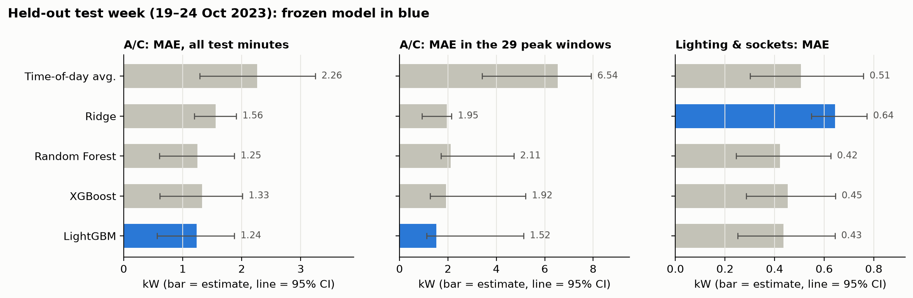

*Figure 12. Test-week MAE for every model with 95% day-block bootstrap intervals: A/C over all minutes (left), A/C in the 29 peak windows (centre), lighting and sockets (right). The frozen model for each target is in blue.*

Figure 12 puts Tables 12 and 13 side by side. For A/C, all four learned models clearly beat the timetable baseline, and the three tree models sit together at about 1.2–1.3 kW. The peak-window panel shows why the peak result needs care: LightGBM has the lowest point estimate (1.52 kW), but its interval is wide (1.11–5.13 kW), because one or two badly estimated afternoons can dominate 29 windows. For lighting, the frozen Ridge model (blue) is the worst on typical error; Section 6.5 explains why. Table 14 shows the robustness check.

*Table 14. Robustness check: A/C, train week 4 → test week 5 (validation, not the sealed test).*

| Model | MAE kW | RMSE kW | R² | Peak-window MAE kW | Energy-share error (pp) |
|---|---|---|---|---|---|
| Time-of-day average | 3.02 | 4.75 | 0.77 | 8.62 | −9.9 |
| Ridge | 2.81 | 3.66 | 0.87 | 4.08 | −4.5 |
| Random Forest | 1.16 | 2.42 | 0.94 | 1.62 | −1.6 |
| XGBoost | **1.16** | **2.33** | **0.95** | 1.49 | −1.6 |
| LightGBM (frozen) | 1.18 | 2.46 | 0.94 | **1.04** | **−1.5** |

### 6.3 Uncertainty and consistency

- **Bootstrap.** The CIs in Tables 12–13 come from 2,000 resamples of whole days (seven calendar dates, six of them full days). Resampling days rather than minutes keeps the within-day correlation, in the spirit of the block bootstrap [38]. Because there are only six full test days, the intervals are wide, and the CIs of LightGBM, Random Forest, XGBoost and Ridge overlap.
- **Cross-validation spread (4 folds).** Across the four expanding CV folds (Appendix B, Table B2), LightGBM's A/C MAE ranged from 0.75 to 1.19 kW (SD 0.22), while Ridge's ranged from 1.37 to 3.01 kW (SD 0.85). Tree models were consistently better than Ridge on typical error in every fold, but peak-window MAE varied a lot between folds for all models (LightGBM 0.98–4.81 kW), because each fold has only a few peak windows.
- **Across weeks.** Trained on one week alone (Table 14), tree models hold steady at an MAE of 1.16–1.18 kW, while Ridge degrades to 2.81 kW.

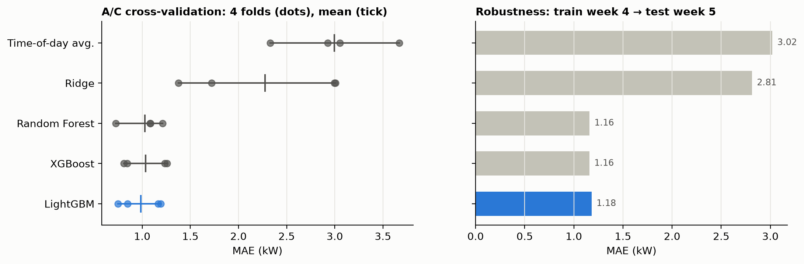

*Figure 13. Consistency of the A/C models. Left: MAE in each of the four expanding-window CV folds (dots) and their mean (tick), at each model's best configuration. Right: MAE when trained on week 4 and tested on week 5.*

Because the bootstrap intervals overlap and the ranking among tree models changes from fold to fold, we do not claim that LightGBM is statistically better than the other tree ensembles, or than Ridge on peak errors. Figure 13 confirms that tree models consistently beat Ridge and the timetable baseline on typical error across folds, weeks and the test week, with LightGBM giving the best overall point estimates. This matters for UTP, because a new building would start with only a short sub-metering period.

### 6.4 Final selection

For the A/C target, we chose LightGBM as the final model. It met the pre-registered freeze rule and achieved the lowest test MAE (1.24 kW) and peak-window MAE (1.52 kW). Random Forest and XGBoost are practically equivalent. Ridge would be the simpler choice, but it misses typical minutes by 26% more and degrades badly when trained on less data (Table 14), which matters when a new building has only a short sub-metering period. Compared with the similarly accurate tree ensembles, LightGBM trains fastest (about 2 seconds on a CPU) and supports exact TreeSHAP explanations, making it transparent and practical for onboarding new UTP buildings with short sub-metering campaigns.

For lighting and sockets, Ridge was chosen by the freeze rule. It was the best lighting model on peak windows but the worst on typical error in the test week, so we keep the frozen choice but do not recommend any lighting model for operational use.

### Part B: Discussion and interpretation

### 6.5 Explain the principal findings

**O2: Main-meter data is sufficient for A/C estimation.** The frozen model reduced typical error by 45% against the timetable baseline (1.24 vs 2.26 kW) and by 21% against Ridge. During peak windows the reduction reached 77% (1.52 vs 6.54 kW), and A/C's share of building energy was estimated to within one percentage point. Unlike the timetable, the model captures day-to-day variation in A/C use, including lighter weekdays such as 24 October.

Ridge has a lower RMSE (2.35 vs 2.57 kW) and tighter confidence intervals, so it makes fewer very large misses. The tree models are better on typical minutes but occasionally miss sharp A/C switching events by several kW. Both behaviours are visible in Figure 16.

**Lighting is a negative result, and we report it as one.** Ridge won cross-validation (MAE 0.360) but was the worst model on typical test-week error (0.64 kW) and under-estimated lighting by 3.0 points of building energy. The reason is drift. The lighting level rose from about 2.4–2.6 kW in the September weeks used for training to 3.1 kW in the October test week, and a linear model extrapolates poorly when that happens. Moreover, lighting and sockets are a small, flat load (around 15% of energy) that changes the main-meter signals very little. Lighting disaggregation from the main meter alone is therefore not reliable with this data, and recommendations involving lighting rely on measured lighting-board data instead.

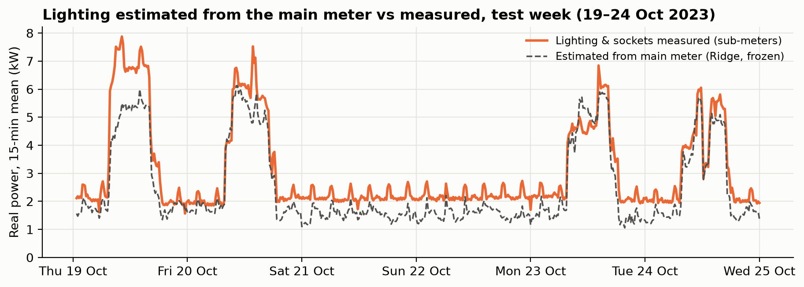

*Figure 14. Lighting-and-socket load estimated from the main meter (frozen Ridge, dashed) versus measured (orange), test week, 15-minute means.*

Figure 14 shows the limitation directly. The estimate follows the weekday on/off pattern, which is why it does well on peak windows, but it runs consistently below the measured load: a week mean of 2.47 kW against 3.07 kW measured. It is also noisy, because it reacts to swings in the main meter that are really A/C. This highlights the difficulty of isolating a small load within the combined building demand.

### 6.6 Visual evidence

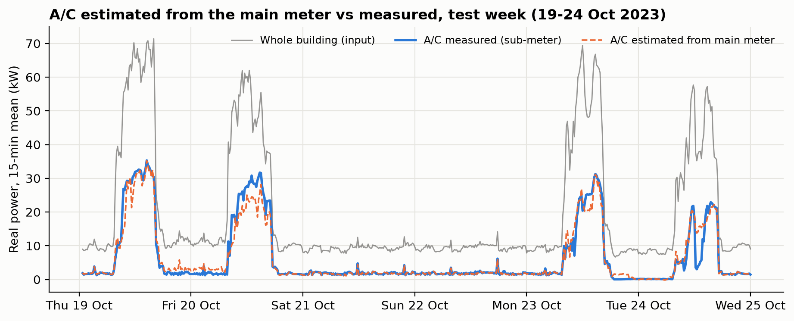

*Figure 15. A/C estimated from the main meter (dashed) versus measured by the sub-meter (blue), with the building total (grey), test week 19–24 October 2023, 15-minute means.*

Figure 15 shows that the estimate follows the daily A/C cycle, including the light Tuesday on 24 October. The largest gaps are on Friday 20 October, when A/C is under-estimated by about 5 kW for most of the afternoon, and around midday on 24 October, when measured A/C briefly drops to about 3 kW but the estimate stays near 15 kW. Night-time and weekend A/C is tracked closely.

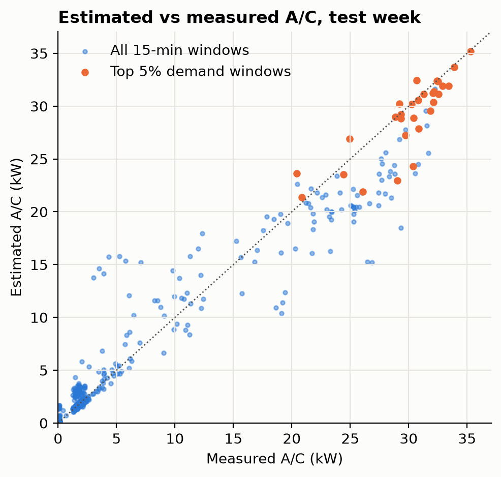

*Figure 16. Estimated versus measured A/C, 15-minute windows of the test week. Orange points are the top-5% building-demand windows; the dotted line is perfect agreement.*

Points cluster around the diagonal, with no strong systematic bias, and most peak windows (orange) sit within a few kW of it. The largest misses are in the middle range and go both ways: some windows with 3–7 kW of measured A/C are estimated at 14–16 kW, and some at 19–27 kW are under-estimated by 5–12 kW. These are the ambiguous mid-load cases discussed below.

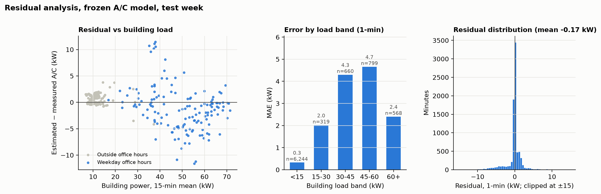

*Figure 17. Residual analysis of the frozen A/C model on the test week. Left: residual (estimated − measured) against building load, 15-minute windows. Centre: MAE by building-load band with the number of minutes. Right: distribution of 1-minute residuals.*

The residuals (Figure 17) are centred close to zero: mean −0.17 kW, median −0.01 kW. 70.9% of minutes are within ±1 kW and 92.5% within ±5 kW, so there is no large systematic over- or under-prediction across the week. Outside office hours the residuals are almost zero. In weekday office hours they fan out in both directions, with a mean of −1.24 kW, so office-hours A/C is slightly under-estimated on average. At 45–65 kW of building load, 84% of office-hours windows are under-estimated, typically by 2–8 kW. The model is conservative on the busiest afternoons, so savings estimates built on it tend to understate peak A/C rather than overstate it. A small cluster at about 36–38 kW is over-estimated by about 10 kW; these are the midday windows on 24 October when the measured A/C briefly dropped (Figure 15). The fan is widest at 30–60 kW of building load and narrows again above 60 kW, which matches the load-band breakdown in Table 15. The distribution has a sharp central peak and long tails on both sides: most minutes are estimated very well, and a small number of switching and mid-load minutes produce the large errors that drive RMSE.

### 6.7 Error and subgroup analysis

*Table 15. Frozen A/C model, test-week MAE by subgroup (n = minutes behind each value).*

| Subgroup | MAE kW | n |
|---|---|---|
| Weekday | 1.78 | 5,710 |
| Weekend | 0.15 | 2,880 |
| Hours 00:00–07:00 (all days) | 0.28–0.58 | 360 per hour |
| Hours 08:00–14:00 (all days) | 2.33–3.38 (worst at 13:00) | 360 per hour |
| Hours 15:00–17:00 (all days) | 0.88–1.82 | 360 per hour |
| Building load < 15 kW | 0.33 | 6,244 |
| 15–30 kW | 2.01 | 319 |
| 30–45 kW | 4.30 | 660 |
| 45–60 kW | 4.66 | 799 |
| ≥ 60 kW | 2.40 | 568 |
| Minutes with a > 5 kW step change | 3.50 | 227 |
| All other minutes | 1.17 | 8,363 |

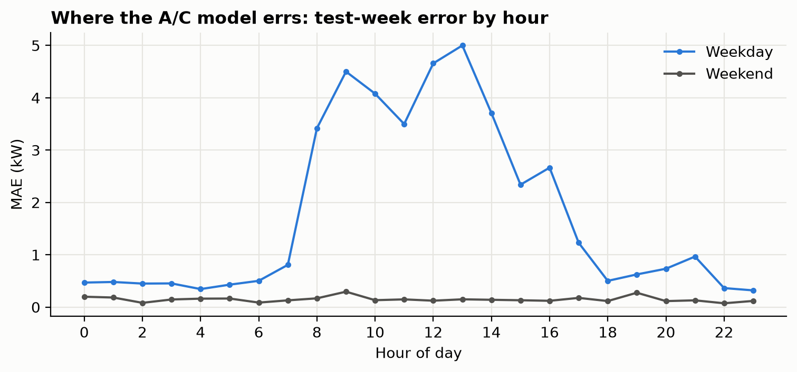

*Figure 18. Mean absolute error of the frozen A/C model by hour of day, weekdays versus weekends, test week.*

**Where and why it fails:**

1. **Weekday mornings and middays (08:00–14:00).** On weekdays alone, the error rises from 3.4 kW at 08:00 to 5.0 kW at 13:00 (Figure 18). This is when A/C ramps up and is least predictable from the timetable.
2. **The 30–60 kW load band.** This is the ambiguous band in Figure 9, where the same building total can hide very different amounts of A/C. Above 60 kW the error falls again (2.40 kW), because at those loads A/C is clearly on.
3. **Sudden steps.** In minutes where the building load changes by more than 5 kW, the error is three times higher (3.50 vs 1.17 kW, n = 227). This is consistent with compressors switching on and off, and with small clock offsets between the separate loggers: a change can appear one minute earlier in the main meter than in the sub-meter.

**Operational consequences.** If the model over-estimates A/C at the peak, facilities would expect more savings from an A/C trim than they would get. If it under-estimates, they could overlook A/C as the cause. The model's estimated A/C share of peak load (44.0%) is close to the measured value (45.4%), so neither error dominates in the windows that matter. After-hours savings estimates are somewhat optimistic, because the model over-estimates night-time A/C by 10–27% (Section 6.8). The weekend error (0.15 kW) is negligible. Subgroups with only a few hundred minutes, such as the step changes (n = 227), rest on four or five days of data, so their exact values should not be over-read.

### 6.8 Explainability and decision usefulness

**O3: What does the A/C model rely on?** We computed exact TreeSHAP values [36], [39] for every test minute. Because many features are exact or near copies of each other, we also summed SHAP within feature groups and ran grouped permutation importance, which shuffles a whole group together, five repeats each.

*Table 16. A/C model importance by feature group (test week).*

| Feature group | Mean \|SHAP\| (kW) | Permutation: MAE rise when shuffled (kW, ± SD) |
|---|---|---|
| Power | 4.97 | 3.93 ± 0.04 |
| Harmonics | 1.20 | 2.11 ± 0.02 |
| Power quality | 0.60 | 0.42 ± 0.01 |
| Calendar | 0.44 | 0.19 ± 0.01 |
| Temporal | 0.26 | 0.42 ± 0.01 |

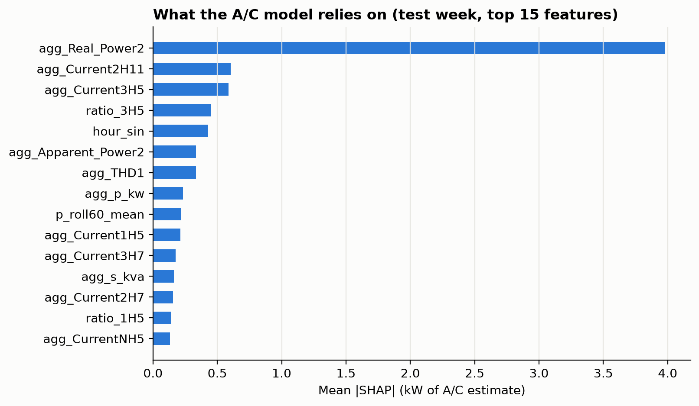

*Figure 19. The 15 features with the largest mean |SHAP| for the frozen A/C model, test week.*

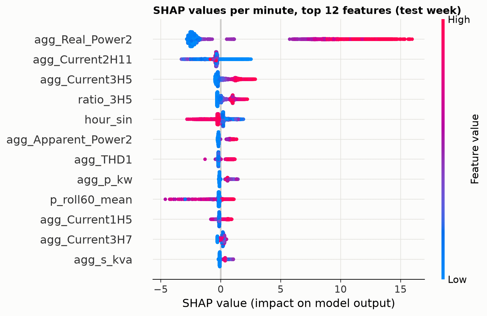

*Figure 20. SHAP value of each test minute for the top 12 features. Colour shows the feature value (red = high).*

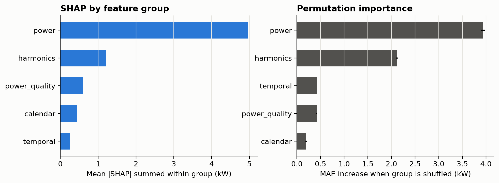

*Figure 21. Feature-group importance: summed SHAP (left) and grouped permutation importance (right).*

- **Phase-2 real power is by far the strongest feature** (mean |SHAP| 3.98 kW). Phase 2 carries the least non-A/C load (5.6 kW mean, against 8.5 kW and 6.3 kW on phases 1 and 3), so its swings are mostly A/C. It also has the highest correlation with A/C (r = 0.946).
- **Next come the 5th, 7th and 11th current harmonics and THD.** These are the characteristic harmonics of six-pulse rectifiers (orders 6k ± 1) [26], which drive the inverters of VRF compressors. The model is therefore using a physically meaningful A/C signature rather than just "the building is busy". In Figure 20, high 5th-harmonic and THD values (red) push the A/C estimate up. The phase-2 11th harmonic works the other way: low values raise the estimate. Because CLEMD reports harmonics as a percentage of the fundamental, a large A/C current raises the fundamental and can lower the relative share of other loads' harmonics. The relationship is therefore not simply "more harmonics = more A/C", and we treat the harmonic group as a signature rather than over-interpret any single order. The ablation agrees: retraining without harmonics raises CV error by 21% (Table 9b).
- **Calendar features matter little on average**, so the model does not just follow the timetable. Retraining without them does, however, worsen peak-window error (Table 9b), so they help place A/C in the busiest windows. SHAP and permutation importance agree on the top two groups. They disagree slightly on the order of temporal and calendar features, and both of those groups are small.

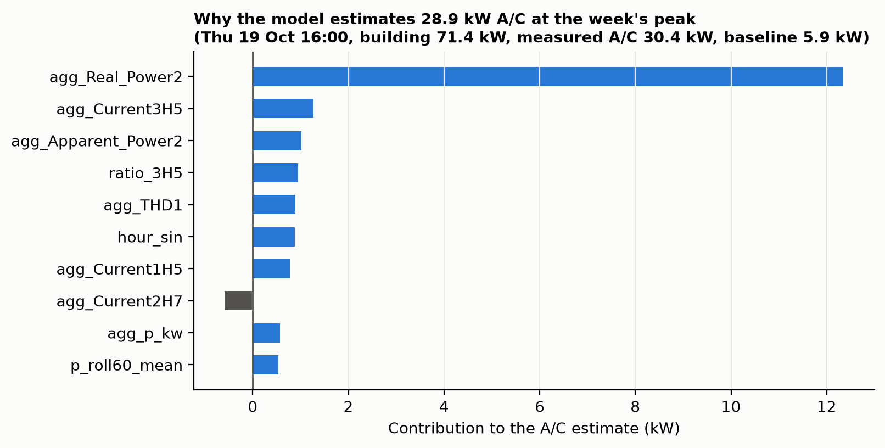

*Figure 22. Why the model estimates 28.9 kW of A/C during the week's highest 15-minute window (Thursday 19 October, 16:00; building 71.4 kW; measured A/C 30.4 kW; model baseline 5.9 kW).*

**A facilities manager's question: "Why does the model think A/C caused this peak?"** Figure 22 answers it for the week's highest window. Phase-2 power adds +12.4 kW above the 5.9 kW baseline. The 5th-harmonic features and THD add about +3.9 kW together, partly offset by the phase-2 7th harmonic (−0.6 kW). The estimate is 28.9 kW against 30.4 kW measured.

**Limits of the explanation.** SHAP explains what the model learned, not what physically causes the load [36]. Credit is split between exact copies (for example `agg_Current3H5` and `ratio_3H5`), which is why we read importance by group. These are associations in one building's data.

**O4: Operating modes and after-hours use.** k-means was run on normalised 24-hour main-meter profiles for the 28 complete days in weeks 2–6. No target was used, so the method works in any building with a main meter.

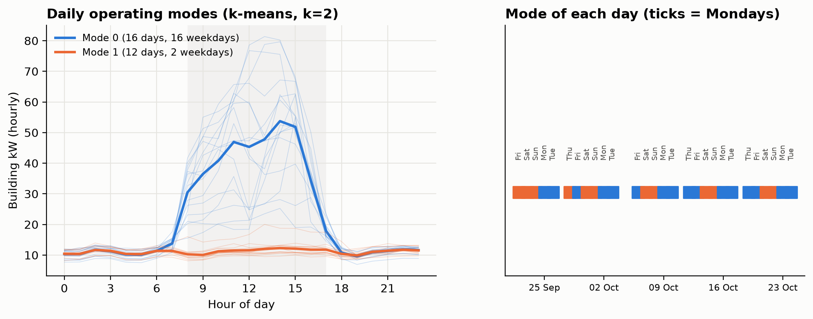

*Figure 23. Daily operating modes found by k-means (k = 2): mean hourly profile per mode with individual days (left), and the mode of each day (right).*

*Table 17. Operating modes (k = 2; silhouette 0.74; k = 3: 0.61; k = 4: 0.54).*

| Mode | Days | Weekdays | Building kWh/day | A/C after-hours kWh/day (measured / estimated) | Lighting after-hours kWh/day (measured) |
|---|---|---|---|---|---|
| 0: working day | 16 | 16 | 561 | 26.4 / 32.6 | 33.4 |
| 1: non-working day | 12 | 2 | 268 | 31.7 / 40.2 | 46.1 |

- Silhouette picks two modes: working days and non-working days. The two weekdays in the non-working mode are Friday 22 September and Thursday 28 September 2023, which was the Maulidur Rasul public holiday [40]. The main meter alone therefore identifies non-working days, with no calendar input, and this is where the clusters differ from the simple weekday/weekend reference grouping.
- With k = 3, a third "light day" mode (375 kWh/day) contains Friday 22 September, Monday 25 September and Friday 29 September, the days around that holiday. This matches the light days we expected in the proposal.
- Non-working days still use about 32 kWh of A/C and 46 kWh of lighting and sockets a day, and overnight A/C averages about 1.3 kW. This is the after-hours target in Section 7.3. Measured A/C exists only for weeks 4–6; the estimated column uses the model's out-of-sample estimates, which run 10–27% high (week 6: 30.6 estimated vs 27.7 measured kWh/day), so savings built on them are somewhat optimistic.

**Decision usefulness.** The model output is directly usable in two ways: an A/C share for every 15-minute window, which can be checked against the peak, and a daily after-hours A/C total, which can be compared between modes. Chapter 7 turns these into actions.

### 6.9 Relationship to prior work

CLEMD's authors reported no ML results [6], and no other CLEMD-based disaggregation studies were identified for direct comparison. The closest Malaysian study used rule-based change-point detection for maximum-demand control [41], which identifies switching events but does not estimate continuous A/C power. This approach is also less suitable for VRF systems with variable-speed compressors [19]. Another Malaysian study explored potential CO₂ savings from NILM feedback [42]. A commercial-building study reported an R² of 96.5% using Random Forest for cooling-load disaggregation [43], compared with 0.93 in this study. However, differences in building type, data period, resolution and evaluation method prevent a direct comparison, and that study is a master's project rather than peer-reviewed work, so we do not claim to be better or worse. Both studies support the suitability of tree-based models for this task. Although deep NILM networks perform well with months of residential data [33], tree models offered a more practical and explainable choice for the limited three-week dataset used in this study.

---

## Chapter 7 Sustainability Insights and Recommendations

> Every UTP figure in this chapter is an estimate (a scenario) for one building the size of the CLEMD building. None of them was measured at UTP. The estimates use the model's A/C predictions for 20 days it never saw during training (weeks 2, 3 and 6). For week 6, where the A/C sub-meter exists, we checked each estimate against the real reading.

### 7.1 Link findings to the Grand Challenge

The project is aligned with the Energy Security Grand Challenge and SDG 7, Target 7.3 (improve energy efficiency). The model supports a decision in five steps:

1. Every UTP building already feeds main-meter data to the i-BMS.
2. The model uses this data to estimate A/C power minute by minute.
3. Facilities staff can then see that A/C causes the peak, and at what time.
4. They can trim A/C output briefly when demand is high, and switch off unneeded A/C after hours.
5. This reduces the building's maximum demand (kW and RM) and energy use (kWh), which also reduces Scope 2 emissions (SDG 13).

**The main meter alone can show what produces the peak.** We looked at the busiest 5% of 15-minute intervals in the test week. The model estimated that A/C supplied 44.0% of the building's load in those periods, while the sub-meter showed 45.4%. The model estimated lighting at 8.3%, and the sub-meter recorded 9.6% (Figure 24). All these peak periods fell on weekdays between 08:00 and 17:00. So, without adding any meters, UTP would be able to tell that A/C is the source of the peak during weekday working hours.

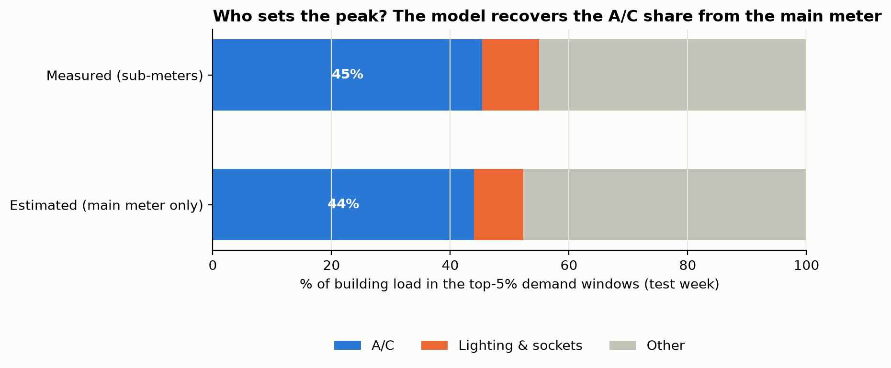

*Figure 24. Share of building load in the test week's top-5% demand windows: measured by sub-meters versus estimated from the main meter only.*

**Solar timing.** Our proposal assumed that the A/C peak comes in the late afternoon, when solar output is dropping. The data show otherwise. UTP's rooftop solar panels produce power from about 08:00 to 18:00. About 77% of the estimated A/C energy (87% of the measured A/C energy in weeks 4–6) is already used in those hours, so A/C already matches the solar hours well (Figure 25). Even at 14:00–16:00, solar output is still 89% of its 11:00–13:00 level.

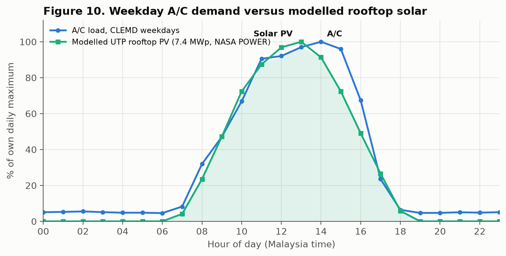

*Figure 25. Weekday A/C demand (CLEMD, measured) versus modelled UTP rooftop PV output (7.4 MWp × NASA POWER irradiance), each as a percentage of its own daily maximum.*

Pre-cooling means running the A/C harder earlier in the day so that it can do less in the afternoon. We tested pre-cooling directly by moving 20% of the 14:00–16:00 A/C energy into an earlier window, with total energy kept the same:

- Moving it to the solar peak (11:00–13:00) made the period's highest demand 5.2 kW higher (5.4 kW using measured A/C). The building is already busy at midday, and its daily peaks can happen at any time from 11:00 to 16:59.
- Moving it to 08:00–10:00, the best option, when solar is at only 35% of its peak, did not lower the highest demand at all (Figure 26).
- On the busiest day, Thursday 19 October, the shift lowered demand at 14:00–15:45 by up to about 7 kW. However, that day's highest demand (71.4 kW) came at 16:00, just after the shifted window, so it did not change.

Because the peak can happen at any point in the afternoon, moving A/C use out of one fixed time slot does not lower it. We therefore withdrew the pre-cooling recommendation from our proposal.

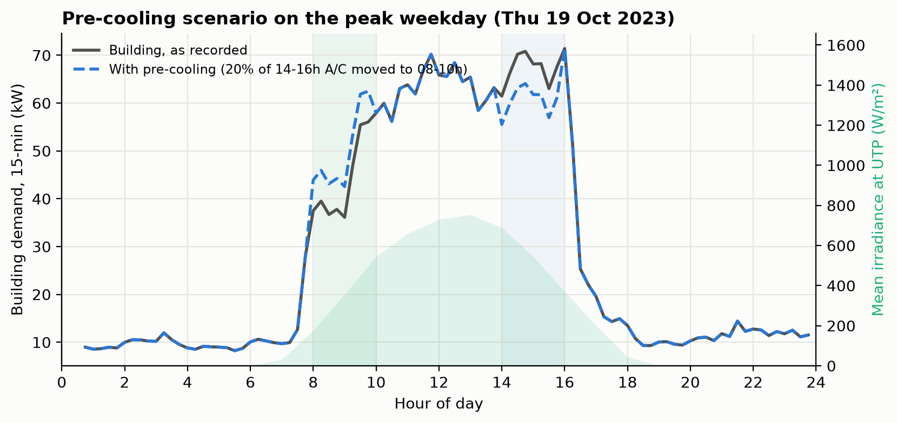

*Figure 26. Pre-cooling scenario on the period's peak weekday (Thursday 19 October 2023): building demand as recorded versus with 20% of 14:00–16:00 A/C moved to 08:00–10:00. The shaded area is mean irradiance at UTP (right axis).*

### 7.2 Actionable recommendations

*Table 18. Recommendations, in priority order.*

| # | Evidence or insight | Stakeholder and action | Expected benefit and condition | When |
|---|---|---|---|---|
| 1 | The main meter correctly reflects A/C's share of the peak (44.0% estimated vs 45.4% measured). All peaks occur on weekdays between 08:00 and 17:00 (Section 7.1) | **UTP Property Management:** only when building demand rises to about its 95th percentile (53 kW here), raise the set-point by about 1 °C or limit capacity by about 20%, using the BMS or VRF controllers | Lower peak demand by about 5.8 kW, or RM 6,200–6,700 per year per building (estimate, Table 19). *Condition:* test occupant comfort first; set the threshold for each building | Now: needs only the main meter and controller settings |
| 2 | Pre-cooling at the solar peak raises the maximum demand by 5.2 kW (Figure 26) | **Property Management and the sustainability office:** do not use fixed-time pre-cooling. Keep the current A/C timing and focus on limiting the peak | Avoids an extra cost of about RM 470–510 a month per building (scenario) | Now |
| 3 | On non-working days the building still uses about 32 kWh of A/C and 46 kWh of lighting and sockets a day, and A/C runs at about 1.3 kW overnight (Table 17) | **Property Management:** check A/C and lighting schedules for after-hours and weekends, turn off A/C zones on non-working days, and use the main-meter day types (clusters) to flag unusual days | About 7.7–9.2 MWh and 5.7–6.8 tCO₂e a year per building (estimate, Table 20). *Condition:* some night loads, such as servers and refrigerators, must stay on | Now: clustering needs no sub-meter |
| 4 | The method works on CLEMD, but much of UTP uses district cooling, lighting estimates are not reliable (Sections 6.5, 8.1), and the adoption plan is not yet reviewed with UTP (Section 7.4) | **Sustainability office and the registered energy manager:** review the plan with UTP stakeholders, then run a pilot on one UTP building's i-BMS data with 2–4 weeks of temporary sub-meters on its AHU and lighting circuits; retrain and check the model | Turns these estimates into measured savings before Recommendations 1 and 3 are implemented campus-wide | Next semester; needs budget and approval |
| 5 | The tree models remain accurate from week to week, but the lighting load changed between September and October (Table 14, Section 6.5) | **Energy manager:** retrain the model every month and track its error (MAE) against any available sub-meter | Keeps the estimates reliable as building use changes during the semester | After the pilot |

Recommendations 1–3 can start now, because they only need the main meter and changes to controller settings. Recommendation 4 must be done before UTP can claim any of these savings as its own.

### 7.3 Quantify impact responsibly

We report three kinds of number separately:

- **Measured** in CLEMD: A/C's share of the peak, after-hours energy on the sub-metered weeks, and model errors.
- **Estimated** scenarios for one CLEMD-sized building: Tables 19 and 20.
- **Possible** future UTP benefits, which require the pilot.

We do not treat a more accurate model as proof of energy savings.

**Peak shaving (lowering the peak).** In this scenario, A/C is cut by *x*% whenever the building's 15-minute demand is at or above its 95th percentile (53.1 kW over the 20 unseen days). We then recompute the new maximum demand, because if the highest period is reduced, another period may become the highest. The starting point is the highest 15-minute demand over those 20 days, 71.4 kW. The demand charge is RM 89.27–97.06 per kW per month (TNB medium voltage, standard or time-of-use tariff) [3], [4].

*Table 19. Peak-shaving scenarios (one building; estimate).*

| A/C trim | Max-demand cut, kW | Week 6 check: estimated / measured A/C | RM per month | RM per year |
|---|---|---|---|---|
| 10% | 2.9 | 2.9 / 3.0 | 258–280 | 3,100–3,400 |
| 20% | 5.8 | 5.8 / 6.1 | 516–561 | 6,200–6,700 |
| 30% | 8.7 | 8.7 / 8.1 | 774–841 | 9,300–10,100 |

The cut calculated from the model's estimates is within 0.6 kW of the cut calculated from the real sub-meter. In this data the highest period stays the highest even after the trim, so the recalculated cut equals the simple maximum possible cut. Our proposal estimated 6.3 kW for a 20% trim, but that figure used the measured peak of 83.9 kW from weeks 4–6. The figures here use model estimates on unseen weeks only.

**After-hours savings and carbon.** This scenario reduces after-hours A/C (model estimate) by 50% and after-hours lighting and sockets (measured) by 30%. The daily average is multiplied by 365 to give a yearly figure. To convert to carbon, Peninsular Malaysia's 2024 grid emission factor of 0.740 tCO₂e/MWh (Energy Commission, provisional) [22] was used, and the result is compared with UTP's 20,270 tCO₂e of emissions from purchased electricity [2].

*Table 20. After-hours savings scenarios (one building; estimate); sensitivity to the office-hours definition.*

| Office hours | A/C after-hours kWh/day (est.) | Lighting after-hours kWh/day | Saved kWh/yr | tCO₂e/yr | % of UTP Scope 2 |
|---|---|---|---|---|---|
| 08–17 | 30.8 | 33.1 | 9,243 | 6.8 | 0.034% |
| 08–18 | 27.9 | 31.3 | 8,528 | 6.3 | 0.031% |
| 07–19 | 25.0 | 28.4 | 7,675 | 5.7 | 0.028% |

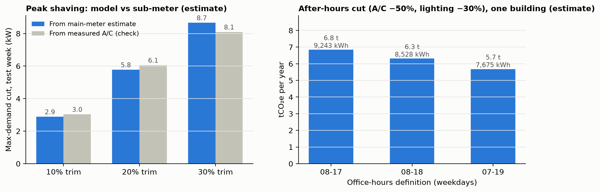

*Figure 27. Scenario results for one CLEMD-sized building (estimates, not measurements). Left: test-week maximum-demand cut from the demand-triggered A/C trim, computed from the model's estimate and checked against the measured A/C. Right: annual savings from the after-hours scenario under three office-hours definitions.*

**Interpretation.** For one building the carbon saving is small, about 6 tCO₂e a year. However, it needs no new equipment, and the same analysis can be repeated for every building that has a meter. The peak-shaving saving, about RM 6,000 a year per building with a 20% trim, gives the stronger financial reason to act. It is the same type of measure as UTP's current management of the DCP's maximum demand, which already saves RM 1.0 million a year [13].

**Assumptions** (all in `scenarios.py`):

- The TNB rates are taken from secondary sources [3], [4] and should be verified against TNB's official tariff schedule [11].
- The emission factor is provisional and will decrease as more renewable energy is added [22].
- The annual figures are based on 20 days in September–October, so they do not include semester breaks or other seasons.
- The 50% and 30% after-hours cuts are assumptions and have not been tested.
- The model's after-hours A/C estimates are 10–27% too high (Section 6.8).
- We assumed a solar performance ratio of 75% to 80%, giving an average peak of 4.2 to 4.5 MW. This changes only the amount of solar power, not the timing results.
- TNB bills according to the peak demand at the campus meter. Cutting one building's peak lowers UTP's bill only if that building is drawing a lot of power when the whole campus peaks.

### 7.4 Adoption and monitoring

The adoption plan below was built from the CLEMD results and from published UTP information only. Because of the project's time frame, it has not yet been reviewed with UTP Property Management, the sustainability office or the registered energy manager. It is therefore a **proposed** plan to be validated with these stakeholders (Section 8.3), not an agreed procedure.

*Table 21. Proposed requirements for adopting and monitoring the demand-triggered A/C trim at UTP (to be validated with UTP stakeholders).*

| Aspect | Requirement |
|---|---|
| **Data the model needs** | A 1-minute main-meter feed with real power per phase, power factor, THD and current harmonics, the same signals used in this study. Public UTP sources confirm that every building has a meter linked to the i-BMS [5], but they do not say which signals are logged. Whether harmonics are recorded is therefore an open question to confirm with UTP facilities at the start of the pilot. Our ablation (Table 9b) shows what is at stake: with total kW only, cross-validated error roughly doubles (2.01 vs 0.99 kW), and with per-phase power but no harmonics it is 1.69 kW. Both are still 33–43% better than the timetable baseline, so the method remains useful on a simpler meter, but less accurate, and it would need re-testing on UTP's actual signals. |
| **Decision rule** | Each building would have its own demand trigger, set near the 95th percentile of its 15-minute demand (53 kW for the CLEMD building), and its own trim size. Both values are proposals from this study and should be agreed with Property Management before use. |
| **People involved** | Facilities operators would carry out the trim, and the registered energy manager required under Act 861 [20] would review the monthly reports. These roles are inferred from Act 861 and UTP's published energy work, not confirmed with UTP. |
| **Review** | Every month, compare the estimated peak with the measured peak and retrain the model (Recommendation 5). |
| **Comfort and fairness** | The trims are small (10–30%) and short. Any UTP trial should collect occupant feedback, because people who feel too warm will override the system. Spaces with vulnerable users or sensitive equipment should be left out. |
| **Privacy** | Building-level electricity data can reveal when spaces are occupied [44]. Reports should stay at building or floor level and be averaged over time, never shown by room or by person. |
| **False alarms** | A trim triggered outside the real peak costs a little comfort but no money. Missing the real peak costs a month of demand charges, so the threshold should be set on the low side. |
| **Tracking real savings** | Compare each month's maximum demand and after-hours kWh with the same month in the previous year. Report savings as *measured* only once the pilot provides real data. |

**Next step: stakeholder validation.** Before any part of this plan is used, it should be presented to UTP Property Management, the sustainability office and the registered energy manager to confirm (1) which signals the i-BMS meters record, (2) whether the proposed trigger and trim sizes are acceptable for occupant comfort, and (3) who would operate and review the system. This is the first step of the pilot in Recommendation 4 and is listed as future work in Section 8.3.

---

## Chapter 8 Limitations, Conclusion and Future Work

### 8.1 Data and methodological limitations

*Table 22. Limitations, their effect and our response.*

| Limitation | Effect on conclusions | Practical response |
|---|---|---|
| One building, about three weeks of A/C ground truth, one season (Sep–Oct 2023) | Results do not generalise to other buildings, semester breaks or hotter months. Six test days give wide CIs | No seasonal claims; CIs reported; Recommendation 4 (pilot) |
| VRF-cooled building vs UTP's district cooling | The trained model cannot be copied to UTP, because the electrical signature differs (fans and pumps instead of compressors) | Transfer the method; retrain on a UTP building with temporary sub-metering |
| Lighting not reliably estimable | Lighting-based savings rely on measured boards, not on the model | Recommendations 3 and 5 rest on measured lighting; the lighting model is not recommended for operational use |
| Unmetered loads (≈ 55% of energy) | Limit the accuracy that can be reached | Realistic, since any main meter sees the same mix |
| Test week was viewed descriptively before the freeze (Section 2.6) | Small risk that our general view of the data was shaped by it | No tuning, selection or ablation used it; the freeze record was committed before the test run |
| Duplicated and constant harmonic features (Section 4.2) | Splits SHAP credit; no effect on accuracy | Group-level interpretation; the ablation shows removing them costs no measurable accuracy (Table 9b) |
| Small tuning grid; ablation on CV only | Models may be slightly under-tuned; the ablation (Table 9b) uses training-week CV, not the sealed test week | Stated; a later sealed week would confirm the ablation |
| After-hours A/C over-estimated by 10–27% | After-hours savings (Table 20) are optimistic | Stated beside each estimate |
| Scenario inputs (secondary-source TNB rates, provisional emission factor, assumed PV ratio, annualisation, office-hours definition) | RM and tCO₂e figures are indicative only | Ranges and sensitivity shown; all labelled as estimates |
| Adoption plan not yet reviewed with UTP stakeholders (Section 7.4) | Meter signals, trigger level, trim size and operating roles are assumptions; Recommendations 1 and 3 cannot yet be confirmed as workable at UTP | Stakeholder review before the pilot (Section 8.3, item 2) |
| Possible logger clock offsets | Errors at step changes (3.5 kW) | 1-minute averaging; flagged in the error analysis |

### 8.2 Conclusion

This project asked one question: can the main meter that every UTP building already has show which loads cause the expensive demand peaks? We tested this on CLEMD's 1-second data from a Malaysian university building, using its sub-meters to check the answers. For air-conditioning, the answer is yes.

*Table 23. Achievement of the project objectives.*

| Objective | Status | Evidence |
|---|---|---|
| Objective 1: Build a clean 1-minute dataset | Achieved | We built a clean dataset of 41,680 one-minute records from 42 raw files and fixed ten recorded data-quality problems (Table 5). The code can rebuild every number from the raw data. |
| Objective 2: Estimate A/C and lighting from the main meter | Achieved for A/C; not achieved for lighting | On the sealed test week, the final LightGBM model estimated A/C power with an average error (MAE) of 1.24 kW. This is 45% better than the timetable baseline and 21% better than Ridge. In peak periods the error was 1.52 kW. LightGBM beat Ridge consistently, but with only six test days we cannot say the difference is statistically significant. The model could not estimate lighting reliably from the main meter. |
| Objective 3: Explain what the model relies on | Achieved | The model mainly uses phase-2 power and the 5th, 7th and 11th harmonics, which inverter A/C compressors produce. This makes physical sense for A/C, and the ablation confirms that harmonics carry information the other features do not (Table 9b). |
| Objective 4: Find daily operating modes and after-hours use | Achieved | Grouping the daily main-meter patterns separated working days from non-working days and correctly placed a public holiday with the non-working days. Even on non-working days the building uses about 32 kWh of A/C a day. |
| Objective 5: Turn estimates into UTP scenarios and recommendations | Achieved, with one proposal idea dropped | Using only the main meter, the model shows that A/C makes up about 44% of the peak. Reducing A/C by 20% only when demand is high would cut this building's maximum demand by about 5.8 kW (RM 6,200–6,700 a year, estimate). Cutting after-hours use would save about 6–7 tCO₂e a year per building. Pre-cooling at the solar peak would raise the peak, so it should not be used. |

For Energy Security, this project shows that UTP's existing meters can identify which load causes the peak, and it gives a tested rule for lowering that peak. The most useful finding is that reducing A/C at moments of high demand lowers the peak, while moving A/C use into solar hours does not. All savings remain estimates until the method is reviewed with UTP stakeholders and tested on a UTP building.

### 8.3 Prioritised future work

1. **Pilot on one UTP building** (solves the problem that UTP uses a different cooling system). Use the building's i-BMS main meter and add temporary sub-meters for 2–4 weeks. Then retrain the model and test it on a later sealed week, following the same steps.
2. **Validate the adoption plan with UTP stakeholders** (resolves the unverified assumptions in Section 7.4). Present the findings to UTP Property Management, the sustainability office and the registered energy manager to confirm which signals the i-BMS meters record, whether the proposed trigger and trim sizes are acceptable, and who would run and review the system. If the meters do not record harmonics, re-test the model using only power and power-factor inputs.
3. **Collect data over a longer period** (solves the one-season problem). A full semester, including breaks, would show how much the load changes over time and how often the model needs retraining.
4. **Retrain on the reduced feature set** (follows from Table 9b). Drop the constant H1 and duplicated ratio columns (no measurable loss), confirm on a later sealed week, and use the kW-only and no-harmonics results to choose the minimum meter specification for UTP buildings.
5. **Test the trim with real occupants** (checks the assumed effect of the trim). Measure how many kW a 10–20% trim really saves and whether people stay comfortable.
6. **Only then try more complex models**, such as forecasting 15 minutes ahead or sequence models, once more data is available.

---

## References

[1] O. Al-Khadher, A. Mukhtaruddin, F. R. Hashim, M. M. Azizan, H. Mamat, and A. Aqlan, "CLEMD: Circuit-level electrical measurements dataset," figshare, dataset collection, 2024. Accessed: Oct. 17, 2026. [Online]. Available: https://doi.org/10.6084/m9.figshare.c.6946581

[2] Universiti Teknologi PETRONAS, "Sustainability @ UTP." UTP. Accessed: Oct. 17, 2026. [Online]. Available: https://www.utp.edu.my/Pages/Sustainability.aspx

[3] Tanand Technology, "Cut your TNB maximum demand charges with EasiEMS," Jul. 29, 2025. Accessed: Oct. 17, 2026. [Online]. Available: https://www.tanand.com.my/tnb-maximum-demand-easiems/

[4] PlusXnergy, "July 2025 TNB tariff update: What Malaysian businesses need to know," 2025. Accessed: Oct. 17, 2026. [Online]. Available: https://www.plusxnergy.com/july-2025-tnb-tariff-update-what-malaysian-businesses-need-to-know/

[5] Universiti Teknologi PETRONAS, "Energy cost optimisation journey." UTP. Accessed: Oct. 17, 2026. [Online]. Available: https://www.utp.edu.my/Pages/Sustainability/Low%20Carbon%20Campus/Energy-Cost-Optimisation-Journey.aspx

[6] O. Al-Khadher, A. Mukhtaruddin, F. R. Hashim, M. M. Azizan, H. Mamat, and A. Aqlan, "CLEMD, a circuit-level electrical measurements dataset for electrical energy management," *Sci. Data*, vol. 11, Art. no. 594, 2024, doi: 10.1038/s41597-024-03433-7.

[7] S. B. Mohd Ali, M. Hasanuzzaman, N. A. Rahim, M. A. A. Mamun, and U. H. Obaidellah, "Analysis of energy consumption and potential energy savings of an institutional building in Malaysia," *Alexandria Eng. J.*, vol. 60, no. 1, pp. 805–820, 2021, doi: 10.1016/j.aej.2020.10.010.

[8] Economic Research Institute for ASEAN and East Asia, "Fundamentals," in *Technical Guideline for Energy Efficiency in Commercial Buildings*. Jakarta, Indonesia: ERIA, 2021, ch. 2. Accessed: Oct. 17, 2026. [Online]. Available: https://www.eria.org/uploads/media/Research-Project-Report/2021-14-Technical-Guideline-Energy-Efficiency-Commercial-Buildings/8_ch.2-Fundamentals.pdf

[9] R. Saidur, "Energy consumption, energy savings, and emission analysis in Malaysian office buildings," *Energy Policy*, vol. 37, no. 10, pp. 4104–4113, 2009, doi: 10.1016/j.enpol.2009.04.052.

[10] Tenaga Nasional Berhad, "Maximum demand." TNB. Accessed: Oct. 17, 2026. [Online]. Available: https://www.tnb.com.my/commercial-industrial/maximum-demand

[11] Tenaga Nasional Berhad, "New electricity schedule: Fairer rates for over 23.6m customers," press clipping, Jun. 23, 2025. Accessed: Oct. 17, 2026. [Online]. Available: https://www.tnb.com.my/assets/newsclip/23062025a.pdf

[12] Tenaga Nasional Berhad, "Tariff reform to reshape power sector," press clipping, Jul. 9, 2025. Accessed: Oct. 17, 2026. [Online]. Available: https://www.tnb.com.my/assets/newsclip/09072025a.pdf

[13] Universiti Teknologi PETRONAS, "District cooling plant (DCP) optimization." UTP. Accessed: Oct. 17, 2026. [Online]. Available: https://www.utp.edu.my/Pages/Sustainability/Low%20Carbon%20Campus/District%20Cooling-Plant-(DCP)-Optimization.aspx

[14] Universiti Teknologi PETRONAS, "UTP and reNIKOLA partner to enhance solar photovoltaic efficiency," press release, Jul. 13, 2024. Accessed: Oct. 17, 2026. [Online]. Available: https://utp.edu.my/Pages/Media/Press-Release/2024/UTP-and-reNIKOLA-Partner-to-Enhance-Solar-Photovoltaic-Efficiency-.aspx

[15] FocusM, "Gentari accelerates Universiti Teknologi PETRONAS' on-site campus solarisation capacity to 7.7MW," *Focus Malaysia*, Aug. 29, 2026. Accessed: Oct. 17, 2026. [Online]. Available: https://focusmalaysia.my/?p=255924

[16] Universiti Teknologi PETRONAS, "Sustainable campus in action." UTP. Accessed: Oct. 17, 2026. [Online]. Available: https://www.utp.edu.my/Pages/Sustainability/Sustainable%20Campus%20in%20Action.aspx

[17] G. W. Hart, "Nonintrusive appliance load monitoring," *Proc. IEEE*, vol. 80, no. 12, pp. 1870–1891, Dec. 1992, doi: 10.1109/5.192069.

[18] A. Zoha, A. Gluhak, M. A. Imran, and S. Rajasegarar, "Non-intrusive load monitoring approaches for disaggregated energy sensing: A survey," *Sensors*, vol. 12, no. 12, pp. 16838–16866, 2012, doi: 10.3390/s121216838.

[19] N. Batra, O. Parson, M. Berges, A. Singh, and A. Rogers, "A comparison of non-intrusive load monitoring methods for commercial and residential buildings," 2014, *arXiv:1408.6595*, doi: 10.48550/arXiv.1408.6595.

[20] Energy Commission of Malaysia, "Energy Efficiency and Conservation Act 2024 (Act 861)," 2025. Accessed: Oct. 17, 2026. [Online]. Available: https://st.gov.my/node/2491

[21] United Nations General Assembly, "Transforming our world: The 2030 Agenda for Sustainable Development," A/RES/70/1, 2015. Accessed: Oct. 17, 2026. [Online]. Available: https://sdgs.un.org/2030agenda

[22] Energy Commission of Malaysia, "Grid emission factor (GEF) in Malaysia, 2022–2024 (provisional)," 2026. Accessed: Oct. 17, 2026. [Online]. Available: https://myenergystats.st.gov.my/documents/d/guest/grid-emission-factor-gef-in-malaysia-2022-2024-provisional-

[23] Ministry of Economy Malaysia, "National energy transition roadmap," 2023. Accessed: Oct. 17, 2026. [Online]. Available: https://www.ekonomi.gov.my/

[24] NASA Langley Research Center, "POWER Project hourly data, version 2.x," dataset, 2026. Accessed: Oct. 17, 2026. [Online]. Available: https://power.larc.nasa.gov/

[25] C. Bergmeir and J. M. Benítez, "On the use of cross-validation for time series predictor evaluation," *Inf. Sci.*, vol. 191, pp. 192–213, 2012, doi: 10.1016/j.ins.2011.12.028.

[26] *IEEE Recommended Practice and Requirements for Harmonic Control in Electric Power Systems*, IEEE Std 519-2014, 2014, doi: 10.1109/IEEESTD.2014.6826459.

[27] A. E. Hoerl and R. W. Kennard, "Ridge regression: Biased estimation for nonorthogonal problems," *Technometrics*, vol. 12, no. 1, pp. 55–67, 1970, doi: 10.1080/00401706.1970.10488634.

[28] L. Breiman, "Random forests," *Mach. Learn.*, vol. 45, no. 1, pp. 5–32, 2001, doi: 10.1023/A:1010933404324.

[29] T. Chen and C. Guestrin, "XGBoost: A scalable tree boosting system," in *Proc. 22nd ACM SIGKDD Int. Conf. Knowl. Discov. Data Mining*, 2016, pp. 785–794, doi: 10.1145/2939672.2939785.

[30] G. Ke *et al.*, "LightGBM: A highly efficient gradient boosting decision tree," in *Adv. Neural Inf. Process. Syst. 30*, 2017, pp. 3146–3154.

[31] J. MacQueen, "Some methods for classification and analysis of multivariate observations," in *Proc. 5th Berkeley Symp. Math. Statist. Probab.*, vol. 1, 1967, pp. 281–297.

[32] P. J. Rousseeuw, "Silhouettes: A graphical aid to the interpretation and validation of cluster analysis," *J. Comput. Appl. Math.*, vol. 20, pp. 53–65, 1987, doi: 10.1016/0377-0427(87)90125-7.

[33] J. Kelly and W. Knottenbelt, "Neural NILM: Deep neural networks applied to energy disaggregation," in *Proc. 2nd ACM Int. Conf. Embedded Syst. Energy-Efficient Built Environ.*, 2015, pp. 55–64, doi: 10.1145/2821650.2821672.

[34] W. McKinney, "Data structures for statistical computing in Python," in *Proc. 9th Python Sci. Conf.*, 2010, pp. 56–61, doi: 10.25080/Majora-92bf1922-00a.

[35] F. Pedregosa *et al.*, "Scikit-learn: Machine learning in Python," *J. Mach. Learn. Res.*, vol. 12, pp. 2825–2830, 2011.

[36] S. M. Lundberg and S.-I. Lee, "A unified approach to interpreting model predictions," in *Adv. Neural Inf. Process. Syst. 30*, 2017, pp. 4765–4774.

[37] J. D. Hunter, "Matplotlib: A 2D graphics environment," *Comput. Sci. Eng.*, vol. 9, no. 3, pp. 90–95, 2007, doi: 10.1109/MCSE.2007.55.

[38] H. R. Künsch, "The jackknife and the bootstrap for general stationary observations," *Ann. Statist.*, vol. 17, no. 3, pp. 1217–1241, 1989, doi: 10.1214/aos/1176347265.

[39] S. M. Lundberg *et al.*, "From local explanations to global understanding with explainable AI for trees," *Nat. Mach. Intell.*, vol. 2, no. 1, pp. 56–67, 2020, doi: 10.1038/s42256-019-0138-9.

[40] Bahagian Kabinet, Perlembagaan dan Perhubungan Antara Kerajaan, Jabatan Perdana Menteri, "Senarai hari kelepasan am persekutuan dan negeri bagi tahun 2023," 2022. **[TODO: add URL and access date after checking the official list.]**

[41] A. Mukhtaruddin, F. R. Hashim, M. K. Awang, H. Mamat, and H. Zakaria, "Development of site-specific non-intrusive load monitoring for maximum demand control," *Indones. J. Electr. Eng. Comput. Sci.*, vol. 23, no. 3, pp. 1814–1824, 2021, doi: 10.11591/ijeecs.v23.i3.pp1814-1824.

[42] K.-K. Kee, Y. S. Lim, J. Wong, and K. H. Chua, "Impact of nonintrusive load monitoring on CO2 emissions in Malaysia," *Bull. Electr. Eng. Inform.*, vol. 10, no. 4, pp. 1803–1810, 2021, doi: 10.11591/eei.v10i4.2979.

[43] M. L. Moreno Guzmán, J. L. Munévar Diaz, and J. J. Jaimes Otero, "Desarrollo de un modelo de análisis de carga no intrusiva para eficiencia energética basado en técnicas de machine learning," M.S. applied project, Pontificia Universidad Javeriana Cali, Cali, Colombia, 2026. Accessed: Oct. 17, 2026. [Online]. Available: https://vitela.javerianacali.edu.co/server/api/core/bitstreams/b3acca3f-2fec-4044-a063-2bf9a1b8788c/content

[44] M. Wickramathilaka, M. P. Abdullah, M. Y. Hassan, and H. Abdullah, "Detection of occupancy status from internet connectivity for non-intrusive load monitoring," *Indones. J. Electr. Eng. Comput. Sci.*, vol. 30, no. 3, pp. 1678–1688, 2023, doi: 10.11591/ijeecs.v30.i3.pp1678-1688.

---

## Appendix A Data Dictionary and Quality Checks

*Table A1. All 98 model features (generated in `results/feature_dictionary.csv`).*

| Group | Features |
|---|---|
| Power (15) | `agg_Real_Power1–3`, `agg_Apparent_Power1–3`, `agg_Reactive_Power1–3` (1-min means, W/VA/VAR); `agg_p_kw`, `agg_q_kvar`, `agg_s_kva` (totals); `agg_p_kw_std`, `agg_p_kw_min`, `agg_p_kw_max` (within-minute) |
| Power quality (16) | `agg_Voltage1–3`, `agg_VoltageN` (V); `agg_Current1–3`, `agg_CurrentN` (A); `agg_Frequency` (Hz); `agg_PF1–3`; `agg_THD1–3`, `agg_THDN` (%) |
| Harmonics (53) | `agg_Current{1,2,3,N}H{1,3,5,7,9,11,13,15}` (% of fundamental; H1 = 100 constant); `ratio_{1,2,3}H{3,5,7,9,11,13,15}` (= Hn/H1, exact copies ÷ 100) |
| Temporal (9) | `p_lag1`, `p_lag5`, `p_lag15`, `p_lag60`; `p_roll15_mean`, `p_roll15_std`, `p_roll60_mean`, `p_roll60_std`; `p_diff1` |
| Calendar (5) | `hour_sin`, `hour_cos`, `dayofweek`, `weekend`, `office_hours` |

*Table A2. Clean 1-minute records per CLEMD week.*

| Week | Dates (2023) | Minutes | Building mean kW | A/C mean kW | Lighting mean kW | Use |
|---|---|---|---|---|---|---|
| 2 | 22–26 Sep | 7,211 | 14.0 | (no file) | 2.59 | Lighting train; clustering; out-of-sample A/C estimates |
| 3 | 28 Sep–3 Oct | 8,651 | 15.7 | (no file) | 2.44 | Same as week 2 |
| 4 | 5–10 Oct | 8,516 | 18.8 | 4.66 | 2.64 | A/C and lighting train (outage removed) |
| 5 | 12–17 Oct | 8,651 | 22.1 | 7.05 | 3.01 | A/C and lighting train |
| 6 | 19–24 Oct | 8,651 | 19.8 | 6.51 | 3.07 | **Sealed test** |

Redundant pairs (|r| > 0.98, weeks 2–5): `results/redundant_feature_pairs.csv` (130 pairs).

## Appendix B Model Settings, Tuning Ranges and Supplementary Results

**Search space** (`train.py`, `MODELS`). Ridge: α ∈ {0.1, 1, 10, 100}. Random Forest (200 trees, max_features 0.33): max_depth ∈ {None, 12} × min_samples_leaf ∈ {1, 5}. XGBoost (400 trees, subsample 0.8, colsample_bytree 0.8): max_depth ∈ {4, 6} × learning_rate ∈ {0.03, 0.1}. LightGBM (400 trees, subsample 0.8, colsample_bytree 0.8): num_leaves ∈ {15, 63} × learning_rate ∈ {0.03, 0.1}. All with `random_state=0`.

*Table B1. Cross-validation results, best configuration per model (mean of four expanding-window folds, training weeks only).*

| Target | Model | CV MAE | CV RMSE | CV R² | CV peak MAE | Fit time (s) |
|---|---|---|---|---|---|---|
| A/C | Time of day | 2.994 | 4.568 | 0.742 | 7.664 | 0.03 |
| A/C | Ridge (α 100) | 2.275 | 3.217 | 0.863 | 4.182 | 0.02 |
| A/C | Random Forest | 1.027 | 2.416 | 0.924 | 3.643 | 7.35 |
| A/C | XGBoost | 1.036 | 2.344 | 0.929 | 2.536 | 1.45 |
| A/C | **LightGBM (frozen)** | **0.987** | 2.365 | 0.929 | 2.587 | 1.98 |
| Lighting | Time of day | 0.429 | 0.753 | 0.580 | 1.456 | 0.05 |
| Lighting | **Ridge (α 100, frozen)** | **0.360** | 0.473 | 0.852 | 0.789 | 0.05 |
| Lighting | Random Forest | 0.363 | 0.544 | 0.811 | 0.896 | 17.24 |
| Lighting | XGBoost | 0.365 | 0.543 | 0.813 | 0.911 | 1.58 |
| Lighting | LightGBM | 0.374 | 0.560 | 0.800 | 0.821 | 2.64 |

*Table B2. A/C CV MAE per fold (kW), best configuration.*

| Model | Fold 1 | Fold 2 | Fold 3 | Fold 4 | SD |
|---|---|---|---|---|---|
| Time of day | 3.67 | 3.05 | 2.33 | 2.93 | 0.55 |
| Ridge | 3.00 | 3.01 | 1.37 | 1.72 | 0.85 |
| Random Forest | 1.09 | 1.21 | 0.73 | 1.08 | 0.21 |
| XGBoost | 0.84 | 1.26 | 0.81 | 1.23 | 0.24 |
| LightGBM | 0.85 | 1.19 | 0.75 | 1.16 | 0.22 |

Full per-fold results for all 136 fits: `results/cv_results.csv`. Freeze record: `results/freeze.json`. Feature-group ablation (Table 9b), all folds: `results/ablation_cv.csv`.

## Appendix C Additional Results

- Lighting Ridge standardised coefficients: `results/ridge_light_coefficients.csv` (largest: THD phase 2, −0.83 kW per SD).
- Local SHAP values at the week's peak: `results/shap_local_peak_ac.csv`.
- Per-day cluster assignments and energy: `results/cluster_days.csv`. k-search: `results/cluster_k_search.csv`.
- Pre-cooling windows tested (20% of 14:00–16:00 A/C moved): 08–10 → 0.0 kW; 09–11 → 0.0 kW; 10–12 → −5.2 kW; 11–13 → −5.2 kW (negative = peak raised). Source: `results/scenarios.json`.
- Out-of-sample predictions for weeks 2, 3 and 6: `results/predictions.csv`.

## Appendix D Implementation Instructions

**Repository:** `ML-ASSIGNMENT/`. This report is `FINAL_REPORT.md` at its root, and all figure links are relative to it. The code is submitted with this report as `Group8_TEB3123_ML_Code.zip`. It includes the processed dataset (`data/processed/clemd_1min.parquet`) and the NASA file, so steps 2–9 run without downloading anything; only `prepare_data.py` (step 1) and a dashboard rebuild need the raw CLEMD folders from figshare.

1. **Environment.** Python 3.11 (tested on 3.11.17, Linux/WSL2).
   ```bash
   uv venv .venv && uv pip install -r requirements.txt
   # or: python -m venv .venv && .venv/bin/pip install -r requirements.txt
   ```
2. **Data** (≈ 7 GB, not in git). Download the six CLEMD weekly folders from https://doi.org/10.6084/m9.figshare.c.6946581 into `data/clemd/<weekly folder>/*.csv`, and the NASA POWER hourly file for UTP (4.385 N, 100.979 E, October 2023, UTC) to `data/external/nasa_power_utp_oct2023_utc.csv`.
3. **Run everything** (about 12 minutes): `./run_all.sh` (or `PY=python ./run_all.sh`). The steps must run in order: `prepare_data → features → train → ablation → evaluate → explain → cluster → scenarios → make_figures → build_dashboard`.
4. **Expected outputs.** `results/*.csv|json` (all numbers in this report), `figures/proposal/`, `figures/results/` and `figures/report/` (every report figure is mapped to its file in Table D1), and `dashboard/index.html` (the presentation).
5. **Checks.** Every script ends with `assert` self-checks; a run with no traceback means the outputs are consistent. All randomness is seeded (`random_state=0`, `default_rng(0)`). Rerunning `train.py` keeps the committed `freeze.json` and asserts that the rerun reproduces the frozen choice.
6. **Rule.** Week 6 is the sealed test week: `features.load()` excludes it unless `include_test=True`, which only `evaluate.py`, `explain.py` and `cluster.py` use, after the freeze.

*Table D1. Report figures and the files that produce them (all under `figures/`).*

| Figure | File | Script |
|---|---|---|
| 1 | `proposal/fig02_energy_vs_peak_share.png` | `make_figures.py` |
| 2 | `proposal/fig01_workflow.png` | `make_figures.py` |
| 3 | `proposal/fig03_data_availability.png` | `make_figures.py` |
| 4 | `report/fig_target_distributions.png` | `report_figures.py` |
| 5 | `proposal/fig04_week6_timeseries.png` | `make_figures.py` |
| 6 | `proposal/fig05_daily_profile.png` | `make_figures.py` |
| 7 | `proposal/fig06_ac_heatmap.png` | `make_figures.py` |
| 8 | `proposal/fig07_feature_correlation.png` | `make_figures.py` |
| 9 | `proposal/fig08_agg_vs_ac.png` | `make_figures.py` |
| 10 | `report/fig_prep_flow.png` | `report_figures.py` |
| 11 | `proposal/fig09_split.png` | `make_figures.py` |
| 12 | `report/fig_model_comparison.png` | `report_figures.py` |
| 13 | `report/fig_consistency.png` | `report_figures.py` |
| 14 | `report/fig_lighting_test.png` | `report_figures.py` |
| 15 | `results/test_week_timeseries.png` | `evaluate.py` |
| 16 | `results/test_pred_vs_actual.png` | `evaluate.py` |
| 17 | `report/fig_residuals.png` | `report_figures.py` |
| 18 | `results/test_error_by_hour.png` | `evaluate.py` |
| 19 | `results/shap_global_top15.png` | `explain.py` |
| 20 | `results/shap_beeswarm.png` | `explain.py` |
| 21 | `results/importance_by_group.png` | `explain.py` |
| 22 | `results/shap_local_peak.png` | `explain.py` |
| 23 | `results/cluster_profiles.png` | `cluster.py` |
| 24 | `results/scenario_peak_drivers.png` | `scenarios.py` |
| 25 | `proposal/fig10_ac_vs_solar.png` | `make_figures.py` |
| 26 | `results/scenario_precooling.png` | `scenarios.py` |
| 27 | `report/fig_scenarios.png` | `report_figures.py` |

## Appendix E Team Contribution Record

All five members contributed equally. Each member led one stage of the ML lifecycle, reviewed another member's stage, and drafted and proofread their chapters of this report. Every piece of code was checked by a second member, and the final pipeline was rerun from raw data before submission.

*Table E1. Team contribution record.*

| Member and ID | Lead responsibility | Review and support | Report chapters | Share |
|---|---|---|---|---|
| Izzatul Najwa Binti Che Zaki (22007298) | Data acquisition, loader, data-quality log, cleaned dataset (`prepare_data.py`) | Feature engineering; leakage checks | Ch. 2 Data Understanding; Ch. 3 Preprocessing | 20% |
| Nurul Izzati Binti Razali (22007868) | Feature engineering, feature dictionary, redundancy check, baselines (`features.py`) | Model tuning; data-quality log | Ch. 4 Feature Engineering; Ch. 1 Introduction | 20% |
| Daphne Binti Douglas (22006239) | Tree models, hyperparameter tuning, model freeze, test evaluation (`train.py`, `evaluate.py`) | Error analysis; baselines | Ch. 5 Methodology; Ch. 6.1–6.4 Results | 20% |
| Siti Nurmasyitah Binti Ab Aziz (22007601) | SHAP, permutation importance, error analysis, clustering (`explain.py`, `cluster.py`) | Test evaluation; scenario checks | Ch. 6.5–6.9 Discussion; Ch. 8 Limitations and Conclusion | 20% |
| Sharvin A/L Kanesan (22006930) | UTP scenarios, integration, figures, dashboard (`scenarios.py`, `report_figures.py`, `build_dashboard.py`) | Clustering; reproducibility rerun | Ch. 7 Sustainability; Executive Summary; Appendices | 20% |
