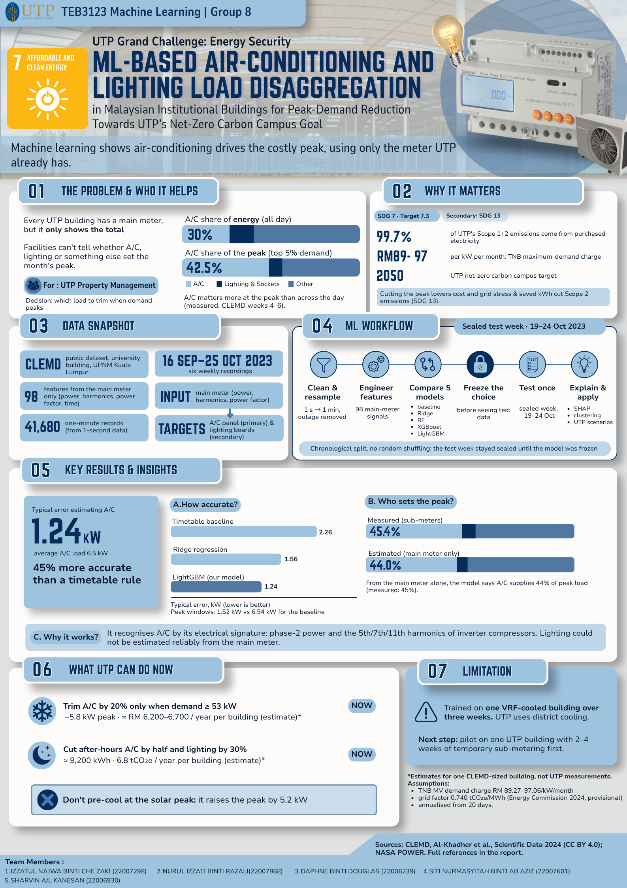

# One-Page Project Infographic: Design Brief

**Project:** ML-Based Air-Conditioning and Lighting Load Disaggregation in Malaysian Institutional Buildings for Peak-Demand Reduction Towards UTP's Net-Zero Carbon Campus Goal
**Course:** TEB3123 Machine Learning · Group 8 · Submission 13 November 2026
**Output:** one A4 portrait page, embedded in `FINAL_REPORT.md` immediately after the Executive Summary

This brief contains everything needed to build the infographic in Canva, PowerPoint, Figma or similar, without reopening the report: rules, layout, exact text, exact numbers, chart data, colours, fonts, icons and a final checklist. Every number is copied from `FINAL_REPORT.md`, and the section it comes from is given so it can be checked.

---

## 1. What the course requires (non-negotiable)

From the TEB3123 report template (`docs/TEB3123_Report_Template_Requirements.md`, §4.3):

| Rule | What it means for us |
|---|---|
| **Exactly one page** | A4 portrait, nothing spills over |
| **Placed immediately after the Executive Summary**, before the Table of Contents | Replace the `[TODO: insert the one-page infographic…]` block in `FINAL_REPORT.md` |
| **Embedded in the report itself** | A separate file does **not** satisfy the requirement. Export a PNG and embed it |
| Summarises **our own completed project** | The course's "Final Report at a glance" image is a guide only; do not reuse it |
| Understandable **without the technical chapters** | Written for UTP Property Management, not for ML people |
| **Six content blocks** | Identity & problem · Sustainability alignment · Dataset snapshot · ML workflow · Key results & insights · Recommendation & limitation |
| Clear hierarchy, short labels, readable at normal page size | See §4 (type sizes) |
| Mix of charts, icons, diagrams and brief explanations | At least two real charts (§6) |
| **No paragraphs of text, no screenshots of code** | Max ~2 lines per text item |
| Numbers **identical** to the report | Use only the copy in §5; run the check in §9 |
| Estimated benefits **labelled as estimates**, with key assumptions | Every RM / tCO₂e figure carries the word "estimate" |
| Concise source credits | One footer line; full references stay in the report |

The infographic has no separate mark weight, but it is mandatory, and it is the first thing the marker sees after the Executive Summary. It also becomes the anchor slide for the Week 11–12 presentation.

---

## 2. What good infographics have in common (research summary)

The advice below comes from university science-communication guides and design references (sources in §12). Where it is a rule of thumb rather than a standard, it says so.

1. **One key message.** A good infographic can be summarised in one sentence. Two or three competing ideas on one layout lose the message [UQ; Piktochart]. → Our sentence is in §3.
2. **Hook → body → takeaway.** Open with the problem, put most of the information in visuals around the key message, and end with what the reader should do [UQ].
3. **Visual hierarchy by importance.** The headline and most important information go first. Hierarchy is created by size, contrast, proximity and white space [Fiveable; Visme].
4. **An obvious reading path.** A first-time reader should know where to look without thinking. Image-led layouts are read in a **Z-pattern** (top-left → top-right → diagonal → bottom); text-heavy layouts in an **F-pattern**. Numbers, arrows and lines reinforce the path [Visme; design-principles references]. → We use a Z-pattern with numbered blocks.
5. **Let visuals carry the content; keep text minimal.** "More text than images" is listed as the most common mistake [UQ; Piktochart].
6. **Choose the layout first.** Colours, fonts and copy can change later, but changing the layout means starting over [Visme]. → Sketch §4 before touching any tool.
7. **Small palette, used consistently.** Typical advice is 3–5 colours, or 2–3 core colours plus neutrals. Once a colour means something (e.g. "A/C"), it must not change meaning [design references; rule of thumb].
8. **Consistent icon style.** The most important icon rule is one style: same stroke weight, detail level and size [design references].
9. **Accurate, consistent, clear charts.** Use the right chart type, no distortion, the same scales and style throughout, label data directly instead of using a legend where possible, and show only what's needed [UQ].
10. **Every number traceable.** Unsourced claims are dismissed regardless of design quality, so list sources at the bottom [ConceptViz; UQ].
11. **Readable in print.** Accessibility guides put 12 pt as the general minimum for text. Esri's infographic guidance uses at least 26 pt for headers, 14 pt for body and 12 pt for captions. Always test with a real A4 printout [Esri; govt.nz; Auckland].
12. **Big numbers can be text.** A very large data point, shown as a big number, is often clearer than a chart [UQ].

---

## 3. The key message (write everything around this)

> **Your building's main meter can already show that air-conditioning sets the costly peak, and a demand-triggered A/C trim (not pre-cooling) is how to cut it.**

Reading path: **Problem** (the meter can't see what sets the peak) → **What we did** (data + ML) → **Proof** (accurate, and recovers A/C's share of the peak) → **Action** (trim A/C at high demand; skip pre-cooling) → **Caveat** (one building, needs a UTP pilot).

---

## 4. Page specification and layout

### 4.1 Canvas

| Item | Value |
|---|---|
| Size | A4 portrait, 210 × 297 mm |
| Export | PNG at **300 dpi = 2480 × 3508 px**, plus a PDF for printing |
| Margins | 12 mm on all sides (safe area 186 × 273 mm) |
| Grid | 12 columns, 4 mm gutters; blocks span 6 or 12 columns |
| Spacing | 6 mm between blocks; 3 mm inside block padding |
| Background | `#FCFCFB` (same off-white as the report figures) |

### 4.2 Typography

Use one sans-serif family throughout: **Inter**, **Source Sans 3** or **Lato** (all free, Google Fonts). In PowerPoint, **Calibri** or **Arial** is fine.

| Element | Size (pt, at A4) | Weight | Colour |
|---|---|---|---|
| Title | 26–30 | Bold | white on header band |
| Sub-title / key message | 14 | Regular | white, 85% |
| Block heading (with number badge) | 15–16 | Bold | `#0B0B0B` |
| Hero numbers | 36–48 | Bold | `#2A78D6` (A/C blue) or `#0B0B0B` |
| Hero-number label | 11–12 | Regular | `#52514E` |
| Body / bullets | **12** (never below 11) | Regular | `#0B0B0B` |
| Chart labels and axis text | 11 | Regular | `#52514E` |
| Footer (sources, team) | 9 | Regular | `#52514E` |

The 9 pt footer is the one deliberate exception to the 12 pt guidance. It holds source credits only, and the full references are in the report. If it looks too small on the printout, cut words rather than shrink further.

### 4.3 Colour palette (validated)

These are the same colours used in every figure of the report, so the infographic and the chapters look like one document. The categorical trio (blue, orange, green) passed a colour-blind-safety check (deuteranopia ΔE 9.2; normal-vision ΔE 27.6).

| Role | Hex | Use |
|---|---|---|
| **A/C** (primary entity) | `#2A78D6` | A/C bars, hero numbers, "frozen model" highlight |
| **Lighting & sockets** | `#EB6834` | lighting segments only |
| **Solar / sustainability** | `#1BAF7A` | SDG block accent, solar icon. *Low contrast on white (2.7:1): never use it for text, only for shapes with a text label beside them* |
| Other / unmetered / baselines | `#C3C2B7` | "Other" segments, baseline bars |
| Header band | `#13294B` (deep navy) | top band and footer rule |
| Ink | `#0B0B0B` | headings, body |
| Ink 2 (secondary) | `#52514E` | labels, captions |
| Surface | `#FCFCFB` | page |
| Block tint | `#EEF4FC` (light blue) | block backgrounds, optional |
| Warning tint | `#FDE6DC` (light orange) | the "don't pre-cool" callout and the limitation box |

Rules: A/C is **always** blue and lighting **always** orange, as in the report. Never use green or orange for text. Never use red or green to mean good or bad.

### 4.4 Wireframe (Z-pattern; heights in mm inside the 273 mm safe area)

```
┌──────────────────────────────────────────────────────────────────┐
│ HEADER BAND (navy)                                         ~34 mm │
│  Title (2 lines max)                       [Energy Security · SDG 7]
│  Key message (1 line)                         Group 8 · TEB3123   │
├───────────────────────────────┬──────────────────────────────────┤
│ ① THE PROBLEM          ~44 mm │ ② WHY IT MATTERS / SDG    ~44 mm │
│  meter icon → "?"             │  SDG 7 tile + 3 icon facts       │
│  hero: 30% → 42.5% bar chart  │  (99.7% Scope 2 · RM 89–97/kW ·  │
│                               │   net-zero 2050)                 │
├───────────────────────────────┴──────────────────────────────────┤
│ ③ DATA SNAPSHOT (4 stat tiles in a row)                    ~30 mm │
│  [41,680 records] [1-s → 1-min] [16 Sep–25 Oct 2023] [98 features]│
├──────────────────────────────────────────────────────────────────┤
│ ④ ML WORKFLOW (6-step horizontal pipeline with icons)      ~32 mm │
│  Clean → Features → 5 models → Freeze → Test once → Explain       │
├───────────────────────────────┬──────────────────────────────────┤
│ ⑤ KEY RESULTS          ~62 mm │ ⑤ continued              ~62 mm │
│  hero: 1.24 kW MAE            │  Chart B: peak share,            │
│  Chart A: MAE bars (3 models) │  measured 45.4% vs est. 44.0%    │
│  "45% better than timetable"  │  insight: harmonic signature     │
├───────────────────────────────┴──────────────────────────────────┤
│ ⑥ RECOMMENDATION & LIMITATION                              ~50 mm │
│  ✔ Trim A/C 20% when demand ≥ 53 kW → −5.8 kW · RM 6.2–6.7k/yr*  │
│  ✔ Cut after-hours use → 6.8 tCO₂e/yr*   ✖ Don't pre-cool (+5.2 kW)
│  ⚠ Limitation box: one VRF building, one season → UTP pilot first │
├──────────────────────────────────────────────────────────────────┤
│ FOOTER: *estimates, one building · sources · team names    ~12 mm │
└──────────────────────────────────────────────────────────────────┘
```

The total is about 268 mm plus gaps. If space runs short, shrink block ② first, never block ⑤.

**Reading path:** ① → ② (top row, left to right), down through ③ and ④ (full-width bands), ⑤ left → right, then ⑥. Put a numbered badge (a circle with 1–6 in it, navy fill, white number) at the top-left of each block. This tells the eye the order and matches the template's six required blocks.

---

## 5. Copy deck: the exact text, block by block

Target: **at most about 220 words on the whole page**, excluding the footer. Use the wording below, or shorten it; don't add to it.

### Header band
- **Title:** `Which load sets the peak? Reading A/C from a building's main meter`
  - The registered full title goes in the footer, because it is too long for a headline. Alternative headline: `AI-Powered Load Disaggregation for Peak-Demand Reduction at UTP`.
- **Key message (sub-title):** `Machine learning shows air-conditioning drives the costly peak, using only the meter UTP already has.`
- **Badges (right side):** `ENERGY SECURITY · SDG 7` (green-accent pill) · `Secondary: SDG 13` (small) · `Group 8 · TEB3123 Machine Learning`

### ① The problem (report §1.2)
- Heading: `The problem`
- Line 1: `Every UTP building has a main meter, but it only shows the total.`
- Line 2: `Facilities can't tell whether A/C, lighting or something else set the month's peak.`
- **Chart 1 (see §6):** A/C share: `30% of energy` → `42.5% of peak demand`
- Caption: `A/C matters more at the peak than across the day (measured, CLEMD weeks 4–6).`
- Stakeholder tag (small pill): `For: UTP Property Management`

### ② Why it matters / sustainability alignment (report §1.1, §1.4)
- Heading: `Why it matters`
- SDG tile: `SDG 7 · Affordable & Clean Energy, Target 7.3 (energy efficiency)`
- Three icon facts:
  - ⚡ `99.7%` `of UTP's Scope 1+2 emissions come from purchased electricity`
  - 💰 `RM 89–97` `per kW per month: TNB maximum-demand charge`
  - 🌱 `2050` `UTP net-zero carbon campus target`
- One-line link: `Cutting the peak lowers cost and grid stress; saved kWh cut Scope 2 emissions (SDG 13).`

### ③ Dataset snapshot (report §2.1, §3.5)
Four stat tiles, each with an icon, a big number and a small label:

| Tile | Big number | Label |
|---|---|---|
| 1 | `CLEMD` | `public dataset, university building, UPNM Kuala Lumpur` |
| 2 | `41,680` | `one-minute records (from 1-second data)` |
| 3 | `16 Sep–25 Oct 2023` | `six weekly recordings` |
| 4 | `98` | `features from the main meter only` |

- Strip under the tiles: `Input: main meter (power, harmonics, power factor)  →  Targets: A/C panel (primary) · lighting boards (secondary)`

### ④ ML workflow (report §5.1, §5.3)
Six steps in a horizontal pipeline with arrows, one icon and 2–4 words each:
1. `Clean & resample`: `1 s → 1 min, outage removed`
2. `Engineer features`: `98 main-meter signals`
3. `Compare 5 models`: `baseline · Ridge · RF · XGBoost · LightGBM`
4. `Freeze the choice`: `before seeing test data`
5. `Test once`: `sealed week, 19–24 Oct`
6. `Explain & apply`: `SHAP · clustering · UTP scenarios`

- Small note under the pipeline: `Chronological split, no random shuffling: the test week stayed sealed until the model was frozen.`

### ⑤ Key results & insights (report §6.2, §6.8, §7.1)
- **Hero number:** `1.24 kW` with label `typical error estimating A/C (average A/C load 6.5 kW)`
- **Chart 2 (see §6):** MAE bars: Timetable baseline 2.26 · Ridge 1.56 · **LightGBM 1.24**
- Callout: `45% more accurate than a timetable rule`
- **Chart 3 (see §6):** peak share: Measured 45.4% vs Estimated 44.0%
- Callout: `From the main meter alone, the model says A/C supplies 44% of peak load (measured: 45%).`
- Insight line (with a "wave" icon): `It recognises A/C by its electrical signature: phase-2 power and the 5th/7th/11th harmonics of inverter compressors.`
- Honesty line (small, Ink 2): `Lighting could not be estimated reliably from the main meter.`

### ⑥ Recommendation & limitation (report §7.2, §7.3, §8.1)
- Heading: `What UTP can do now`
- ✔ (blue) `Trim A/C by 20% only when demand ≥ 53 kW` → `−5.8 kW peak · ≈ RM 6,200–6,700 / year per building (estimate)`
- ✔ (blue) `Switch off A/C & lighting after hours` → `≈ 9,200 kWh · 6.8 tCO₂e / year per building (estimate)`
- ✖ (orange-tint box) `Don't pre-cool at the solar peak:` `it raises the peak by 5.2 kW`
- ⚠ Limitation box (orange tint): `Trained on one VRF-cooled building over three weeks. UTP uses district cooling, so pilot on one UTP building with 2–4 weeks of temporary sub-metering first.`

### Footer
- Line 1: `*Estimates for one CLEMD-sized building, not UTP measurements. Assumptions: TNB MV demand charge RM 89.27–97.06/kW/month; grid factor 0.740 tCO₂e/MWh (Energy Commission 2024, provisional); annualised from 20 days.`
- Line 2: `Data: CLEMD, Al-Khadher et al., Scientific Data 2024 (CC BY 4.0); NASA POWER. Full references in the report.`
- Line 3: `Group 8: Izzatul Najwa · Nurul Izzati · Daphne · Siti Nurmasyitah · Sharvin | Full title: ML-Based Air-Conditioning and Lighting Load Disaggregation… Towards UTP's Net-Zero Carbon Campus Goal`

---

## 6. The three charts (data and how to draw them)

Keep charts flat and simple: no 3D, no shadows, no gridlines except a faint baseline. Label values directly on or beside the bars, with no legend box where direct labels fit. All bars start at zero.

### Chart 1: "A/C matters more at the peak" (block ①)
Two horizontal 100% stacked bars.

| Bar | A/C (`#2A78D6`) | Lighting & sockets (`#EB6834`) | Other (`#C3C2B7`) |
|---|---|---|---|
| All 15-min windows (share of **energy**) | 30% | 14% | 56% |
| Top 5% demand windows (share of **peak**) | 42.5% → label "42%" | 9% | 49% |

Label only the A/C segments ("30%", "42%"), in white bold. Source: report Figure 1 / `figures/proposal/fig02_energy_vs_peak_share.png` (that image can be cropped and reused directly).

### Chart 2: "How accurate?" (block ⑤ left)
Horizontal bars, MAE in kW, lower is better, sorted worst to best from top to bottom.

| Model | MAE (kW) | Colour |
|---|---|---|
| Timetable baseline (time-of-day average) | 2.26 | `#C3C2B7` |
| Ridge regression | 1.56 | `#C3C2B7` |
| **LightGBM (our model)** | **1.24** | `#2A78D6` |

Axis label: `Typical error, kW (lower is better)`. Optional small note: `Peak windows: 1.52 kW vs 6.54 kW for the baseline`. Don't add confidence intervals here, because they need explanation; they are in the report (Figure 12).

### Chart 3: "Who sets the peak?" (block ⑤ right)
Two horizontal 100% stacked bars, the same style as Chart 1 so the reader sees the link.

| Bar | A/C | Lighting & sockets | Other |
|---|---|---|---|
| Measured (sub-meters) | 45.4% | 9.6% | 45.0% |
| Estimated (main meter only) | 44.0% | 8.3% | 47.7% |

Label the A/C segments "45%" and "44%". Source: `figures/results/scenario_peak_drivers.png` (can be cropped and reused).

**Optional fourth visual**, only if space allows: a tiny sparkline of the test week (measured vs estimated A/C) cropped from `figures/results/test_week_timeseries.png`, about 25 mm tall. Drop it before shrinking any text.

---

## 7. Icons

Use **one icon set only**, in outline style with the same stroke weight, coloured `#13294B` or `#52514E`, at 7–9 mm square. Free, licence-clear sets:
- **Lucide** (lucide.dev, ISC licence) or **Google Material Symbols** (Apache 2.0). Both are available inside Canva and Figma, or as SVG.

| Where | Concept | Suggested icon (Lucide / Material name) |
|---|---|---|
| ① | building meter | `gauge` / `speed` |
| ① | unknown cause | `circle-help` / `help` |
| ② | electricity | `zap` / `bolt` |
| ② | money / tariff | `banknote` / `payments` |
| ② | net-zero | `leaf` / `eco` |
| ③ | dataset | `database` / `database` |
| ③ | time span | `calendar` / `calendar_month` |
| ③ | features | `sliders-horizontal` / `tune` |
| ④ | clean | `filter` / `filter_alt` |
| ④ | models | `git-compare` / `compare` |
| ④ | freeze | `lock` / `lock` |
| ④ | test | `flask-conical` / `science` |
| ④ | explain | `lightbulb` / `lightbulb` |
| ⑤ | signature / harmonics | `audio-waveform` / `graphic_eq` |
| ⑥ | air-conditioner trim | `snowflake` / `ac_unit` |
| ⑥ | after-hours | `moon` / `bedtime` |
| ⑥ | don't | `circle-x` / `cancel` |
| ⑥ | limitation | `triangle-alert` / `warning` |

Don't mix emoji with icons in the final design; the emoji in §5 are placeholders only. Don't use the official UN SDG icon unless you follow the UN's SDG logo usage guidelines; a plain text tile "SDG 7" in the green accent is safer.

---

## 8. Step-by-step build (about 2–3 hours)

1. **Sketch (15 min).** Draw the §4.4 wireframe on paper or a blank slide. Agree it with the group before building, because changing the layout later means starting over.
2. **Set up the canvas (10 min).**
   - **Canva:** Custom size 210 × 297 mm. Add a 12-column grid via Settings → Show rulers and guides.
   - **PowerPoint:** Design → Slide Size → A4 portrait. View → Guides.
   - **Figma:** Frame "A4" with a 12-column layout grid.
3. **Lay down the blocks (20 min).** Draw the header band, block rectangles and numbered badges with the spacing in §4.1. Set the colours from §4.3 as document colours.
4. **Charts (30 min).** Build Charts 1–3 from the tables in §6 with the tool's bar-chart element, or crop the existing report PNGs listed in §6 (they already use the right colours). Delete legends and label directly.
5. **Text (30 min).** Paste the copy from §5 exactly. Apply the type scale in §4.2. If a line wraps to three lines, shorten the words, not the font size.
6. **Icons (20 min).** Place the §7 icons at one size and one colour.
7. **Check (20 min).** Run the §9 number check and the §10 quality checklist. Print it on A4.
8. **Export (5 min).** PNG at 300 dpi (2480 × 3508 px) as `figures/infographic.png`, plus a PDF copy for printing.
9. **Embed (5 min).** In `FINAL_REPORT.md`, replace the whole `> **[TODO: insert the one-page infographic…` block (and the content table under it) with:

   ```markdown
   

   *Project infographic. All benefits shown are estimates for one CLEMD-sized building; see Chapter 7.*
   ```

   When the report is exported to PDF, make sure the image falls on its own page right after the Executive Summary (insert a page break before and after it).

---

## 9. Number consistency check (tick every row)

Every number on the infographic must match the report exactly.

| Number on infographic | Report location | ✓ |
|---|---|---|
| 99.7% of Scope 1+2 from purchased electricity | §1.1, Executive Summary | ☐ |
| RM 89–97 per kW per month (RM 89.27–97.06) | §1.1, §7.3 | ☐ |
| 2050 net-zero | §1.1 | ☐ |
| A/C 30% of energy → 42.5% of peak | §1.2, Figure 1 | ☐ |
| 41,680 one-minute records | §3.5, Table 8 | ☐ |
| 16 Sep–25 Oct 2023 | §2.1, Table 3 | ☐ |
| 98 features | §4.1, Table 9 | ☐ |
| 5 models (baseline, Ridge, RF, XGBoost, LightGBM) | §5.2, Table 10 | ☐ |
| Test week 19–24 Oct 2023 | §5.3 | ☐ |
| MAE 1.24 kW; average A/C 6.5 kW | §6.2, Table 12 | ☐ |
| Baseline 2.26, Ridge 1.56 | Table 12 | ☐ |
| 45% better than the timetable baseline | §6.5 | ☐ |
| Peak-window MAE 1.52 vs 6.54 kW (if used) | Table 12 | ☐ |
| Peak share 44.0% estimated vs 45.4% measured | §7.1, Figure 24 | ☐ |
| 20% trim when ≥ 53 kW → 5.8 kW, RM 6,200–6,700/yr | §7.3, Table 19 | ☐ |
| After-hours ≈ 9,200 kWh (9,243), 6.8 tCO₂e/yr | §7.3, Table 20 (08–17 definition) | ☐ |
| Pre-cooling raises the peak by 5.2 kW | §7.1 | ☐ |
| 0.740 tCO₂e/MWh | §7.3 | ☐ |
| 2–4 weeks temporary sub-metering pilot | §7.2, Table 18 | ☐ |

Figure and table numbers refer to the current `FINAL_REPORT.md`. If the report is rebuilt, re-check them.

---

## 10. Quality checklist before embedding

**Content**
- [ ] All six required blocks are present and numbered 1–6
- [ ] The key message (§3) can be read in under 10 seconds from the header and block ⑤
- [ ] Every RM, kWh and tCO₂e figure says "estimate" or carries the asterisk that the footer explains
- [ ] The limitation is visible, not hidden in the footer
- [ ] Footer has the source credits and team names
- [ ] No paragraphs (no text item longer than 2 lines); no code screenshots

**Design**
- [ ] Exactly one A4 page; nothing within 12 mm of the edge
- [ ] One font family; sizes follow §4.2; body text ≥ 12 pt (footer 9 pt only)
- [ ] A/C is blue and lighting orange everywhere, matching the report figures
- [ ] Green and orange are never used for text
- [ ] One icon style, one icon size
- [ ] Bars start at zero; values labelled directly; no 3D or shadows
- [ ] White space between blocks is equal (6 mm)

**Tests**
- [ ] **Print test:** print on A4 at 100% and read every label at arm's length [Auckland; Esri]
- [ ] **Squint test:** squint at the page. The title, the three hero numbers (42.5%, 1.24 kW, 44%) and the recommendation should still stand out
- [ ] **Greyscale test:** print or view in greyscale. The charts still read, because segments are labelled
- [ ] **Stranger test:** show it to someone outside the course for 30 seconds and ask what UTP should do. They should say something like "trim A/C at the peak"
- [ ] **Group check:** every member has seen it (the team record says all members reviewed the final version)

---

## 11. Common mistakes to avoid

| Mistake | Why it hurts | Our guard |
|---|---|---|
| More text than visuals | Reads as a compressed report, not an infographic [UQ] | ~220-word cap; copy deck in §5 |
| Several competing messages | No focus, looks messy [UQ] | One key message (§3) |
| Inconsistent numbers vs report | Template requires identical values; markers check | §9 table |
| Benefits shown as facts | Template requires estimates to be labelled | Asterisk + footer assumptions |
| Rainbow or too many colours | Colour stops meaning anything | Palette in §4.3 |
| Mixed icon styles | Looks amateur [design references] | One set (§7) |
| Truncated or 3D bar charts | Distorts the data [UQ] | Bars from zero, flat |
| A single big chart pretending to be an infographic | Not an infographic [UQ] | Six blocks, three charts, stat tiles |
| Tiny text to squeeze content in | Unreadable when printed | Cut words, not font size |
| Reusing the course's "at a glance" image | Explicitly not allowed by the template | Build from scratch |
| Separate file only | Fails the requirement | Embed in `FINAL_REPORT.md` (§8 step 9) |

---

## 12. Sources consulted for the design guidance

- University of Queensland, "Designing and creating science infographics." [https://clips.uqcloud.net/infographics/](https://clips.uqcloud.net/infographics/)
- Piktochart, "Bring Data to Life With These 8 Infographic Design Tips." [https://piktochart.com/blog/infographic-design-tips/](https://piktochart.com/blog/infographic-design-tips/)
- Visme, "Infographic layout" and "Infographic best practices." [https://visme.co/blog/infographic-layout/](https://visme.co/blog/infographic-layout/) · [https://visme.co/blog/infographic-best-practices/](https://visme.co/blog/infographic-best-practices/)
- Fiveable, "Designing effective infographics" (data journalism study guide). [https://fiveable.me/data-journalism/unit-7/designing-effective-infographics/study-guide/Vn77T2kHBAVAtuSo](https://fiveable.me/data-journalism/unit-7/designing-effective-infographics/study-guide/Vn77T2kHBAVAtuSo)
- Venngage, "Infographic design." [https://venngage.com/blog/infographic-design](https://venngage.com/blog/infographic-design)
- UPEI Infographics Manual, "Designing the infographic." [https://pressbooks.library.upei.ca/infographicsmanual/chapter/designing-the-infographic/](https://pressbooks.library.upei.ca/infographicsmanual/chapter/designing-the-infographic/)
- ConceptViz, "Scientific infographic design guide." [https://conceptviz.app/blog/scientific-infographic-design-guide](https://conceptviz.app/blog/scientific-infographic-design-guide)
- UNTHSC Library, "Posters: data visualization." [https://libguides.unthsc.edu/posters/data-visualization](https://libguides.unthsc.edu/posters/data-visualization)
- Utrecht University, "Posters and Infographics." [https://skillsearthsciences.sites.uu.nl/wp-content/uploads/sites/805/2022/03/09-Posters-and-Infographics-Addink_Redacted.pdf](https://skillsearthsciences.sites.uu.nl/wp-content/uploads/sites/805/2022/03/09-Posters-and-Infographics-Addink_Redacted.pdf)
- Esri, "Infographic design best practices: text." [https://www.esri.com/arcgis-blog/products/bus-analyst/sharing-collaboration/infographic-design-best-practices-text](https://www.esri.com/arcgis-blog/products/bus-analyst/sharing-collaboration/infographic-design-best-practices-text)
- New Zealand Government, "Designing documents for print." [https://govtnz.github.io/web-a11y-guidance/ka/accessible-ux-best-practices/designing-documents-for-print](https://govtnz.github.io/web-a11y-guidance/ka/accessible-ux-best-practices/designing-documents-for-print)
- University of Auckland, "Designing academic posters." [https://flexiblelearning.auckland.ac.nz/designing-academic-posters/4_9.html](https://flexiblelearning.auckland.ac.nz/designing-academic-posters/4_9.html)
- Pearson, "Accessibility basics for print." [https://a11y.pearson.com/wp-content/uploads/2022/06/Accessibility-basics-for-print-v4.pdf](https://a11y.pearson.com/wp-content/uploads/2022/06/Accessibility-basics-for-print-v4.pdf)

Most of these are design blogs or university teaching pages. They agree with each other, but numbers such as "3–5 colours" are conventions, not formal standards.
