<div align="center">

<picture>
  <source media="(prefers-color-scheme: dark)" srcset="figures/readme/hero-dark.png">
  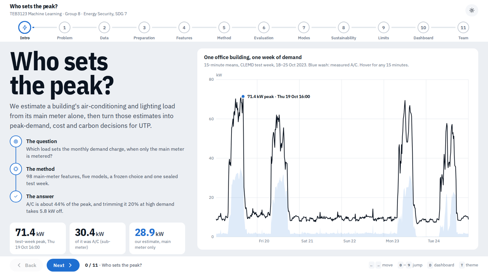
</picture>

# Who sets the peak?

**A building's air-conditioning and lighting load, estimated from its main meter alone.**

Then turned into peak-demand, cost and carbon decisions for Universiti Teknologi PETRONAS.


**built with**


[Results](#headline-results) · [Quick start](#quick-start) · [Pipeline](#pipeline) · [Team](#team)

</div>

---

## The problem in one picture

Every UTP building has a main meter, but it only shows the **total**. The monthly TNB demand charge (about RM 89–97 per kW) is set by the single worst 15 minutes, and nobody can see which load caused it. In the CLEMD building, A/C is **30% of the energy but 43% of the peak**, and every peak falls in weekday office hours.

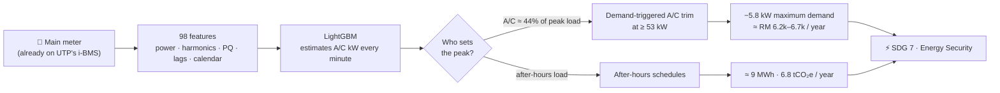

> All RM, kWh and tCO₂e figures are **scenarios for one CLEMD-sized building**, not UTP measurements. The numbers come from `results/scenarios.json`; the full method is in Chapter 7 of the final report.

## Headline results

<table>
<tr>
<td width="50%" valign="top">

**Who sets the peak?** Top-5% demand windows of the sealed test week, measured by sub-meters:

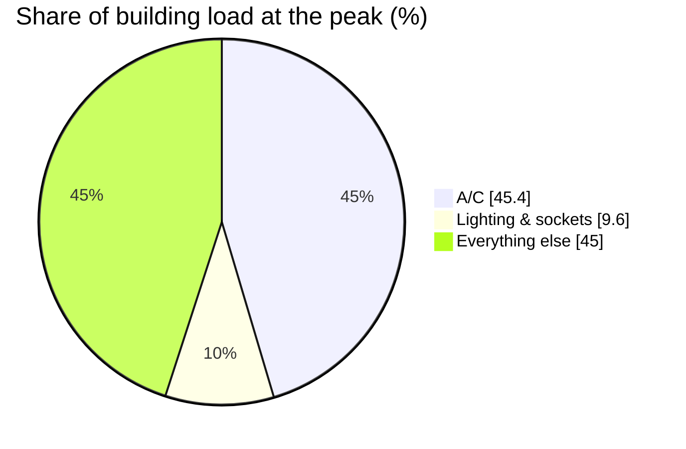

From the main meter alone, the model estimates A/C at **44.0%** (measured: 45.4%).

</td>
<td width="50%" valign="top">

**How accurate?** A/C error on the sealed test week (lower is better):

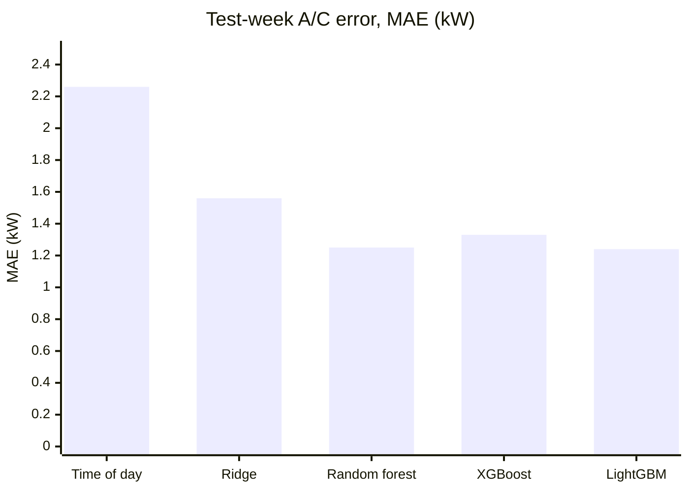

LightGBM (frozen): **1.24 kW** on a 6.5 kW load, 45% below the timetable baseline.

</td>
</tr>
</table>

| | Result | Evidence |
|---|---|---|
| 🎯 **A/C estimate** | MAE **1.24 kW** (95% CI 0.56–1.87), peak-window MAE **1.52 kW** | `results/test_metrics.csv` |
| 🔍 **Why it works** | Phase-2 power and the 5th/7th/11th harmonics of inverter compressors | `results/shap_groups_ac.csv` |
| 🧪 **Ablation** | Without harmonics: +21% error. kW-only meter: 2× error, still beats the timetable | `results/ablation_cv.csv` |
| 📅 **Operating modes** | The main meter alone finds the Maulidur Rasul public holiday | `results/cluster_days.csv` |
| ❌ **Pre-cooling** | Our proposal's idea **raises** the peak by 5.2 kW, so we dropped it | `results/scenarios.json` |
| ⚠️ **Lighting** | Not reliably estimable from the main meter (reported as a negative result) | `results/test_metrics.csv` |

<p align="center">
  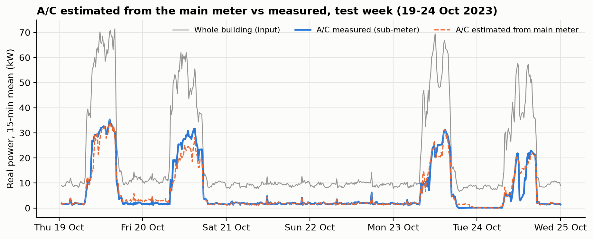
  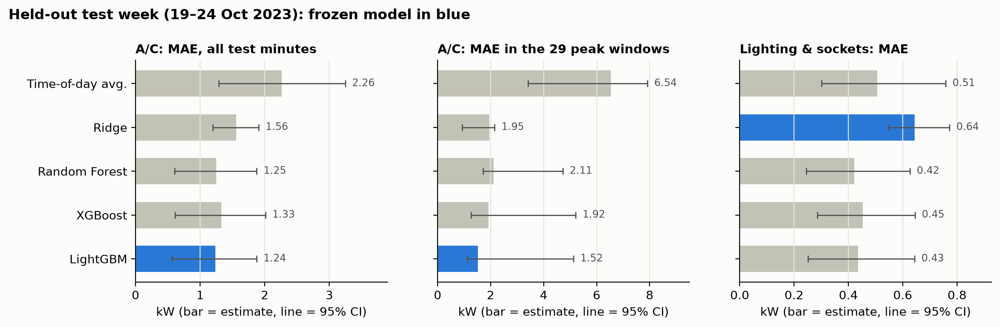
</p>
<p align="center">
  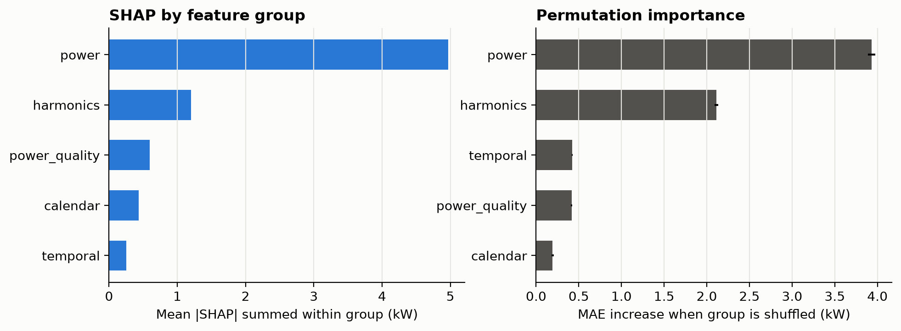
  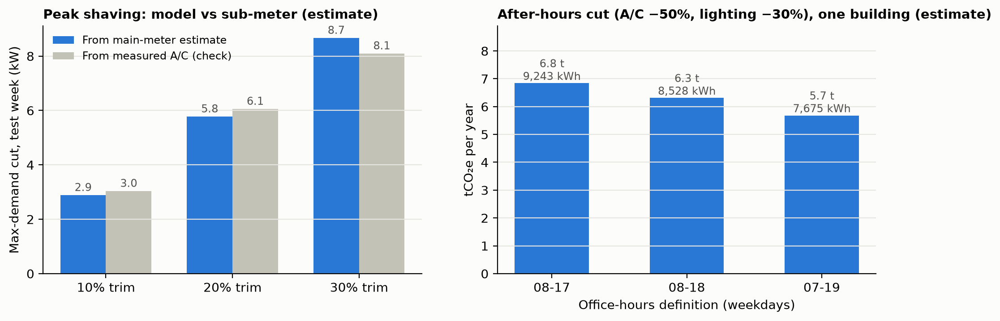
</p>

## Quick start

```bash
# 1. environment (Python 3.11; versions pinned)
uv venv .venv && uv pip install -r requirements.txt   # or: python -m venv .venv && .venv/bin/pip install -r requirements.txt

# 2. run everything and open the dashboard (~13 min)
./run_all.sh

# just open the dashboard, or run only some steps
./run_all.sh ui
./run_all.sh ablation build_dashboard
```

### Data

| File | Size | Where it comes from |
|---|---|---|
| `data/clemd/<six weekly folders>/*.csv` | ≈ 5.9 GB | CLEMD on figshare: [doi.org/10.6084/m9.figshare.c.6946581](https://doi.org/10.6084/m9.figshare.c.6946581). Open the link, download each weekly dataset, extract into `data/clemd/` |
| `data/processed/clemd_1min.parquet` | 15 MB | Made by `prepare_data.py`. With this file you can run every step except 1 and 10 without the raw data |
| `data/external/nasa_power_utp_oct2023_utc.csv` | 16 KB | NASA POWER hourly irradiance, UTP (4.385 N, 100.979 E), Oct 2023 |

Without the raw CLEMD folders, run the steps that only need the parquet:

```bash
./run_all.sh features train ablation evaluate explain cluster scenarios make_figures report_figures
```

## Pipeline

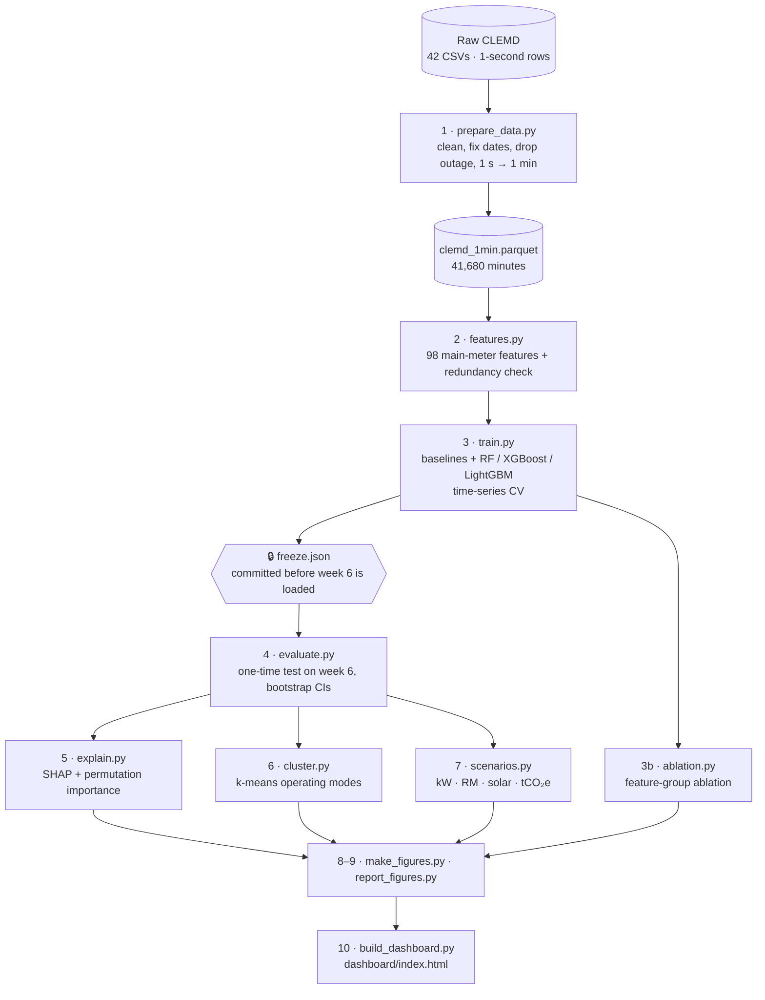

| Step | Script | Output |
|---|---|---|
| 1. Clean + resample 1 s → 1 min (weeks 2–6) | `prepare_data.py` | `data/processed/clemd_1min.parquet` |
| 2. Feature dictionary + redundancy check | `features.py` | `results/feature_dictionary.csv`, `results/redundant_feature_pairs.csv` |
| 3. Baselines + RF/XGBoost/LightGBM, time-series CV, **model freeze** | `train.py` | `results/cv_results.csv`, `results/freeze.json` |
| 3b. Feature-group ablation (dev weeks only, frozen settings) | `ablation.py` | `results/ablation_cv.csv` |
| 4. One-time test on week 6, bootstrap CIs, robustness, error analysis | `evaluate.py` | `results/test_metrics.csv`, `results/predictions.csv`, … |
| 5. SHAP + permutation importance | `explain.py` | `results/shap_*.csv`, `results/permutation_importance_groups.csv` |
| 6. k-means operating modes, after-hours energy | `cluster.py` | `results/cluster_*.csv` |
| 7. UTP scenarios (kW, RM, solar, tCO₂e) | `scenarios.py` | `results/scenarios.json` |
| 8. Problem/data figures (EDA, workflow, split) + headline stats | `make_figures.py` | `figures/proposal/` |
| 9. Extra report figures (distributions, residuals, model comparison, scenarios) | `report_figures.py` | `figures/report/` |
| 10. Presentation walkthrough + stakeholder dashboard | `build_dashboard.py` | `dashboard/index.html` |

Steps run in this order; each reads the previous step's output. Every script ends with `assert` self-checks, so a clean run with no traceback means the outputs are consistent. All randomness is seeded (`random_state=0`, `default_rng(0)`), so a rerun regenerates the same `results/`.

### How the data is split

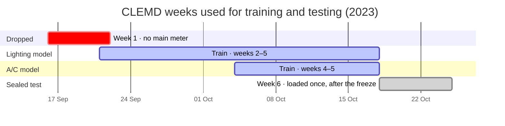

## Rules we follow

- 🔒 **Week 6 is the sealed test week.** Nothing before the freeze loads it (`features.load()` drops it by default).
- ⏱️ **Chronological splits only.** A/C trains on weeks 4–5, lighting on weeks 2–5; lags never cross a data gap; CV leaves a 60-minute gap between train and validation.
- 📝 **The freeze rule was written down first.** A tree model is chosen only if it beats Ridge's CV error by at least 5%. After `freeze.json` is committed, the model, features and search space don't change; rerunning `train.py` writes `freeze_rerun.json` and checks the choice is reproduced.
- 🏷️ **Scenarios are labelled as scenarios.** No accuracy gain is ever turned into a claimed energy saving.

## Dashboard

<p align="center">
  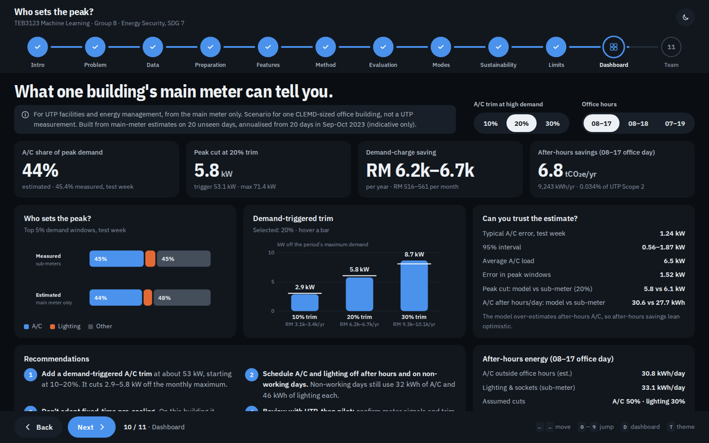
</p>

`dashboard/index.html` is one offline file: an 11-step walkthrough of the project plus a stakeholder dashboard and a team page. Every chart has hover tooltips.

| Key | Action |
|---|---|
| `←` `→` | Previous / next step |
| `0`–`9` | Jump to a step |
| `D` | Stakeholder dashboard |
| `T` | Light / dark theme |

It is generated from `dashboard/template.html` and the files above; rerun `build_dashboard.py` after any result changes. Rebuilding needs the raw CLEMD folders (the data step reads a raw sample); the shipped `index.html` is already built. Team phone numbers are read from an optional `public/phones.json`, which is not included.

<p align="center">
  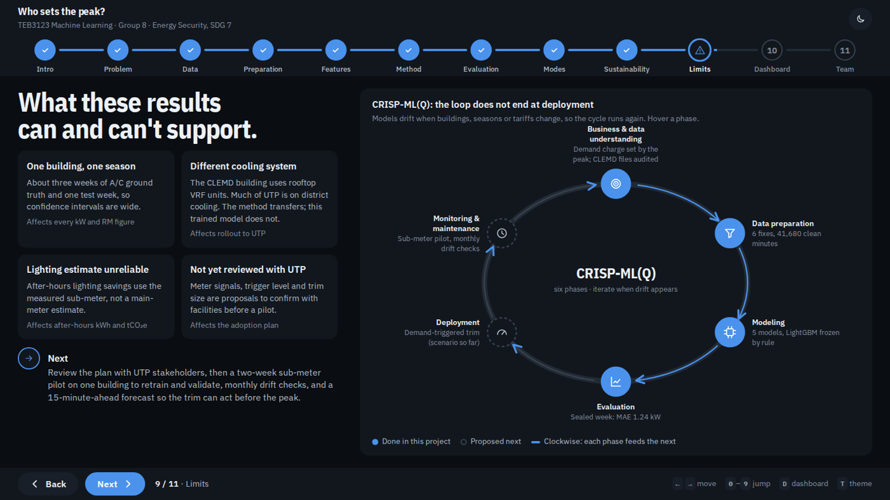
</p>

## Limitations

One building, about three weeks of A/C ground truth and one season, so confidence intervals are wide. The CLEMD building uses rooftop VRF units while much of UTP is on district cooling: the **method** transfers, this trained model does not. The adoption plan has not yet been reviewed with UTP stakeholders. Full list: Section 8.1 of the final report.

## License

[MIT](LICENSE) © 2026 Sharvin A/L Kanesan and Group 8. The CLEMD dataset is CC BY 4.0 (Al-Khadher et al., *Scientific Data* 2024, [doi:10.1038/s41597-024-03433-7](https://doi.org/10.1038/s41597-024-03433-7)). Solar data from the NASA Langley Research Center POWER Project.

## Team

**Group 8 · TEB3123 Machine Learning · Lecture Group 2**

<table>
<tr>
<td align="center" width="20%"><br><b>Izzatul Najwa Binti Che Zaki</b><br><sub>22007298</sub><br><sub>Data acquisition, cleaning and quality log</sub></td>
<td align="center" width="20%"><br><b>Nurul Izzati Binti Razali</b><br><sub>22007868</sub><br><sub>Feature engineering and baselines</sub></td>
<td align="center" width="20%"><br><b>Daphne Binti Douglas</b><br><sub>22006239</sub><br><sub>Tree models, tuning, freeze and test</sub></td>
<td align="center" width="20%"><br><b>Siti Nurmasyitah Binti Ab Aziz</b><br><sub>22007601</sub><br><sub>Explainability, error analysis and clustering</sub></td>
<td align="center" width="20%"><br><b>Sharvin A/L Kanesan</b><br><sub>22006930</sub><br><sub>Scenarios, figures, integration and dashboard</sub></td>
</tr>
</table>

<div align="center"><sub>Universiti Teknologi PETRONAS · September 2026</sub></div>
